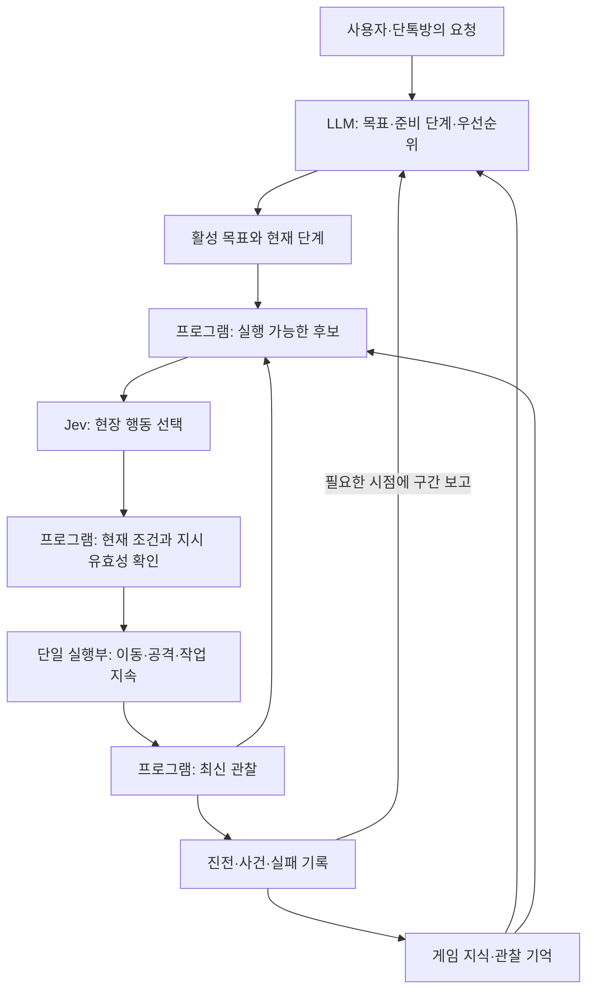

# Core Keeper AI 캐릭터 — LLM·프로그램·Jev 행동설계 v2

작성일: 2026-11-03. 상태: 사용자 검토용 보완 설계. 구현 계약 확정, 실게임 검증, 설치·유료 API 실행을 의미하지 않는다.

이번 요청은 “여태까지 수집한 자료를 바탕으로 설계를 다시 보완해줘”다. [기존 초안](2026-11-03-jev-행동설계.md)에 [일반 게임 AI·LLM 선행사례](2026-11-03-게임행동판단-선행사례.md), [Jev 실제 활용 추가 조사](2026-11-03-jev활용사례-추가조사.md), 이후의 역할 비교와 LLM 결과 점검 논의를 반영했다.

## 1. 유지하는 방향과 이번에 보완하는 부분

사용자가 제시한 방향은 LLM이 전체 목표를 잡고, Jev가 상황에 따른 행동을 선택하며, 프로그램이 캐릭터를 실제로 움직이는 것이다. 변화 없는 행동 중에는 호출을 줄이고, 전투 중에도 LLM이 철수 같은 목표 변경을 할 수 있어야 한다. 이 방향을 유지한다.

이번 보완은 행동 선택 앞뒤를 연결한다. LLM은 준비가 필요한 목표까지 계획하고, 프로그램은 지금 실행할 수 있는 후보를 만들며, Jev는 그 안에서 현장 행동을 고른다. 실행 결과는 프로그램이 관찰하고 LLM에는 목표 진행과 중요한 변화만 묶어서 보낸다. LLM이 매 행동을 승인하는 구조로 만들지 않는다.

다음은 이번 문서의 설계 제안이며 사용자에게 이미 확정받은 계약으로 기록하지 않는다.

- LLM 점검을 단계 완료·계획 전제 변화·반복 실패·주기 점검으로 묶는 기준.
- 계획에 필요한 행동·선행조건 목록과 당장 실행할 후보를 분리하는 방식.
- 결과 보고 형식, 요청 중 사건 보존, 반복 정체 처리, 판단기 비교 방법.

2026-10-21의 ‘프로그램 성향 점수부터 시작하고 Jev는 비교 후보’라는 잠정 기록은 역사로 남긴다. 이 문서는 Jev를 행동 판단자로 두는 보완안이며, 실제 채택 여부는 비교와 사용자 판단으로 정한다. 전투를 Jev에 맡기려는 의도를 지키기 위해 프로그램의 자동 회피·자동 후퇴를 기본안에 추가하지 않는다.

게임 설치와 모드 로드는 최근 기록에서 확인됐지만 AIPlayerSpike의 월드 내 STEP1~3 시험은 미완료다. 캐릭터 몸, 관찰 가능한 정보, 이동·전투·가방 조작 범위는 아직 검증 대상이다. context.md와 단톡방 자체의 기억·프롬프트 설계는 변경하지 않는다.

## 2. 전체 흐름과 판단 권한

| 담당 | 책임 | 대신 하지 않는 판단 |
|---|---|---|
| LLM | 목적과 완료 조건, 준비 단계, 캐릭터 성향에 따른 우선순위, 접근법 변경·철수·재개 | 공격·이동 매 입력의 승인 |
| Jev | 현재 목표 안에서 작업·대상·짧은 이동·전투·회복·대기 선택 | 구현되지 않은 동작 생성, 전체 사용자 목표를 임의 폐기 |
| 프로그램 | 관찰, 거리·경로·실행 조건 계산, 후보 구성, 입력 실행, 실제 결과 판정, 사실 집계 | 전투가 불리하다는 이유로 몰래 다른 전술 선택 |

이 구성은 논리적 역할 구분이다. 별도 서비스나 프레임워크를 여러 개 도입해야 한다는 뜻은 아니다. 게임 스레드는 네트워크를 기다리지 않고, 실제 캐릭터 입력은 한 실행부만 소유한다. LLM과 Jev는 직접 키를 누르거나 서로 경쟁하는 실행기를 만들지 않는다.

명시적 사용자 제약은 목표 선호보다 우선한다. LLM은 그 제약 안에서 목표를 조정하고 Jev는 활성 목표 안에서 행동을 선택한다. 프로그램은 지원되지 않는 동작이나 깨진 실행 조건을 거부할 수 있지만, 거부 후 다른 전투 행동을 자동으로 고르지는 않는다. 물리적으로 불가능한 명령을 막는 일과 유리한 전술을 대신 정하는 일을 구분한다.

## 3. 목표와 준비 단계: 지금 못 한다고 계획에서도 사라지지 않게

LLM에 전달하는 행동 지식에는 다음 세 상태를 구분한다.

| 상태 | 뜻 | 처리 |
|---|---|---|
| 지금 실행 가능 | 구현된 행동이며 현재 대상·도구·위치 조건이 맞음 | Jev의 현재 후보가 될 수 있음 |
| 준비하면 실행 가능 | 구현된 행동과 필요한 조건이 확인됐지만 지금 일부 조건이 부족함 | LLM의 준비 단계 계획에 제약·필요 자원과 함께 제공 |
| 기능·지식 미확인 또는 미구현 | 몸이 지원하는지, 게임 규칙이 무엇인지, 필요한 동작이 구현됐는지 모름 | 불확실성·기능 부족으로 보고. 실행 가능한 계획 단계로 확정하지 않음 |

예를 들어 어떤 광물을 캐려면 특정 도구가 필요하다는 사실이 확인됐다고 가정하자. ‘채굴 후보 없음’만 주면 목표가 끊긴다. LLM에는 필요한 도구와 확보 방법, 해당 행동의 구현 여부를 알려 ‘준비 → 접근 → 채굴’로 계획할 수 있게 한다. 제작 기능이 없다면 제작을 수행했다고 가정하지 않고, 보유 도구로 가능한 다른 목표나 사람의 도움을 검토한다. 이 예시는 설계 설명용이며 Core Keeper의 특정 광물·도구·제작법을 사실로 확정한 것이 아니다.

초기에는 행동 목록과 선행조건을 연결한 작은 표면 충분하다. GOAP 계획기나 지식그래프 엔진을 반드시 도입하지 않는다. LLM이 현재 목표에 필요한 짧은 준비 단계만 작성하고 프로그램은 단계 전환을 실제 관찰로 확인한다. 미리 정한 단계의 완료 조건이 충족되면 다음 단계로 넘어갈 수 있지만, 뜻밖의 조건을 새로운 목표로 해석하는 일은 LLM에 돌린다.

목표에는 다음 정보를 둔다.

- 캐릭터·목표 ID와 수정 번호, 요청 출처.
- 목적과 관찰 가능한 완료 조건. ‘구리 30개’가 현재 가방 보유량인지 이번 목표의 새 획득량인지 명확히 한다.
- 현재 단계와 준비 조건, 단계가 중단됐을 때의 상태.
- 반드시 지킬 사용자 제약과 가능한 한 지킬 성향·선호.
- 알려진 관련 지식과 아직 모르는 조건.
- 일시 우회 목표라면 원래 목표, 복귀 조건, 자동 재개가 허용되는 범위.

목표·단계·제약의 변경이 다음 행동 판단을 바꾸면 수정 번호를 갱신한다. 위치나 재고의 매 관찰 갱신은 별도 관찰 시점으로 구분해 목표 번호를 불필요하게 올리지 않는다.

LLM의 ‘끝났다’는 문장은 완료 증거가 아니다. 프로그램이 최신 위치·보유량 등 확인 가능한 사실로 조건을 판정한다. 확인 수단이 없으면 완료 미확인으로 남긴다.

## 4. 선택지는 행동 틀에 실제 상황을 연결해 만든다

코드에는 재사용 가능한 행동을 구현한다. 후보는 그 행동에 현재 관찰한 대상·지점·물건을 연결한 것이다. `이동`이 하나의 틀이라면 ‘광맥 A 접근’, ‘동료 B 접근’, ‘관찰된 통로 C의 끝까지 확인’이 구체 후보가 된다. 사건마다 전용 문장을 전부 미리 쓰는 방식은 아니다.

| 행동 틀 | 상황별 후보 예시 | 실행 종료를 확인할 사실 |
|---|---|---|
| 관찰된 지점으로 이동 | 광맥 접근, 동료 접근, 귀환 지점 접근 | 허용 범위 내 도착 또는 경로 막힘 |
| 탐색 구간 진행 | 미탐색 갈림길 확인, 가능한 경계 탐색 | 새 구역 관찰, 지정 구간 끝, 진행 불가 |
| 특정 대상 작업 | 광석 채굴, 보이는 아이템 획득 | 대상 변화와 실제 획득량, 작업 조건 소실 |
| 특정 적 공격 | 적 A 공격, 현재 대상 공격 유지 | 명령의 실행 범위 종료, 대상 무효화, 공격 진행 관찰 |
| 짧은 전투 이동 | 지정 지점 이동, 특정 적과 거리 벌리기 | 도착, 시간·거리 범위 종료, 실행 조건 소실 |
| 사용·대기 | 확인된 회복 수단 사용, 유한 시간 대기 | 실제 소모·상태 변화 또는 대기 종료 |

방패·구르기·회피 스킬처럼 구체적인 능력은 실제 몸·장비와 게임에서 지원됨을 확인한 뒤 등록한다. ‘거리 벌리기’도 프로그램이 새 전술을 택한다는 뜻이 아니라 Jev가 그 행동을 선택한 뒤 지정된 이동 규칙을 실행하는 것이다.

각 후보에는 행동 ID·대상·실행 인자, 현재 가능한 이유, 필요한 조건, 확인된 비용과 예상 효과, 완료·중단·실패 조건, 유지 가능한 범위를 둔다. 피해량·성공률을 모르면 모른다고 쓴다. 예상 효과는 결과 관찰과 분리한다.

후보 생성은 목표 관련 행동뿐 아니라 현재 필요한 대응의 가능성을 보존한다. 채굴 목표라고 전투·회복·대기 후보를 전부 제거하지 않는다. 명시적 제약 위반이나 실행 불가능만 제거하고, 전술적으로 좋지 않아 보인다는 이유만으로 후보를 없애지 않는다. 같은 의미의 중복은 묶되 대상·경로·효과가 다른 대안을 유지한다. 후보가 너무 많으면 빠진 행동 계열과 생략 기준을 기록해 누락을 찾을 수 있게 한다. 처음부터 거대한 다단계 선택 트리를 도입하지 않는다.

현재 행동이 유효하면 ‘계속하기’를 제공한다. 새 행동과 중단·대기의 의미가 다르면 그 선택도 표현한다. 후보 하나가 남았다는 이유만으로 프로그램이 새로운 전투 행동을 선택하지 않는다. 모델 호출 없이 이어갈 수 있는 것은 이미 선택된 행동의 유효한 지속 실행이나 그 행동 계약에 포함된 기계적 다음 단계다.

## 5. 지속 실행과 호출: 진행 중에는 유지하고 판단이 달라질 때 묻는다

Jev는 매 프레임의 키 입력 대신 의미 있는 행동 단위를 고른다. ‘관찰된 통로의 지정 지점까지 이동’, ‘이 광석을 채굴’, ‘이 적을 대상으로 정해진 짧은 범위만 공격’처럼 실행부가 진행과 종료를 확인할 수 있어야 한다. 동일 행동·대상을 다시 고르면 재시작하지 않고 계속한다.

프로그램은 관찰과 결과 기록을 계속하지만 Jev 호출은 다음 변화에 묶는다.

- 행동 완료·실패·중단 또는 진행이 기대 범위 안에서 멈춤.
- 관련 대상·통로·자원·적의 발견이나 소실.
- 행동 후보의 의미 있는 변화, 체력·소모품·거리 등 판단 전제 변화.
- 활성 목표·현재 단계·사용자 제약의 변경.
- 실행 범위가 끝나 다음 행동을 정해야 함.

동일 상태라는 기준에는 위치만 아니라 목표, 현재 행동, 진행량, 관련 위험, 후보의 실행 조건을 포함한다. 정체 시간과 반복 실패 횟수는 별도로 누적한다. 같은 장면에서 멈춰 있다고 호출을 영원히 생략하지 않는다. 무진전 감지는 작업별 정상 소요 시간과 관찰 가능한 진전을 기준으로 하며, 상세 시간값은 실제 시험 후 정한다.

전투에서는 관찰과 후보를 계속 갱신한다. 캐릭터당 하나의 Jev 요청을 진행하고, 그동안 생긴 변화는 최신 요청 대기 상태로 합친다. 순간마다 모든 사건을 따로 보내지 않는다. 응답 사이에는 유효한 현재 행동만 정해진 범위 안에서 수행한다. 공격 대상 자동 변경, 무기 임의 교체, 위험하다는 이유의 자동 회피·후퇴는 기본에 없다.

응답이 늦거나 실패하면 유효한 현재 행동은 허용 범위까지만 지속한다. 범위가 끝났거나 실행 조건이 깨졌으면 입력을 해제하고 대기 상태를 기록한다. 이것은 안전을 보장하는 전술이 아니다. 타임아웃·재시도 횟수는 제한하고 연결 실패를 LLM 보고 사건으로 묶는다. 코드가 임의로 다른 행동을 고르거나 API 실패를 성공처럼 감추지 않는다.

고정 0.1초 응답은 전제하지 않는다. 보고된 다른 프로젝트의 빠른 값도 우리 환경의 보장이 아니다. 게임 제어 주기, 호출 시도 빈도, 응답 처리량, 관찰부터 행동 적용까지 걸린 시간은 별도로 측정한다.

## 6. 명령 수락과 행동 결과를 구분한다

실행 기록은 최소한 다음을 구분한다.

1. **선택:** Jev가 어떤 후보를 골랐는가.
2. **적용:** 현재 조건을 통과해 실행부가 명령을 시작·유지했는가.
3. **진행:** 이동 거리·획득량·소모·관찰된 전황이 어떻게 변했는가.
4. **종료:** 완료, 실패, 중단, 목표 변경으로 취소, 결과 미확인 중 무엇인가.

‘이동 명령 수락’은 도착이 아니고 ‘공격 입력 발생’은 타격이나 처치가 아니다. 적이 시야에서 사라진 것만으로 사망을 확정하지 않는다. 광석이 사라져도 가방에 들어왔는지, 다른 곳에 떨어졌는지 관측을 통해 구분한다. 구체적인 판정 능력은 몸·관찰 시험에서 확인한다.

원시 기록은 행동 ID와 시간으로 연결해 필요할 때 원인을 볼 수 있게 한다. 보통은 프로그램이 관찰값의 전후 차이와 사건을 집계하고 모델이 읽을 요약을 만든다. 매 행동마다 LLM으로 요약문을 생성하지 않는다. 관측되지 않은 원인이나 동기를 집계 과정에서 만들어 넣지 않는다.

## 7. LLM은 목표 진행과 계획의 유효성을 확인한다

LLM 점검 단위는 버튼이나 공격 한 번이 아니라 ‘목표 아래에서 수행한 구간’이다. 구간은 광맥 발견·작업 완료·전투 종료 같은 사건으로 닫거나, 정체·중요 변화·점검 시점에서 중간 보고할 수 있다. 모든 구간 기록이 곧 LLM 호출은 아니다.

| 재판단 계기 | 프로그램이 모을 사실 | LLM이 결정할 것 |
|---|---|---|
| 의미 있는 단계 완료 | 획득량, 도착 위치, 남은 조건 | 다음 단계 유지·보완, 목표 완료 후 다음 목적 |
| 계획 전제 변화 | 도구 조건 불일치, 가방 부족, 길 단절, 적 증원, 요청 변경 | 준비 단계 추가, 접근법 변경, 목표 조정 |
| 반복 실패·무진전 | 시도와 결과, 실패 조건, 탐색 진전, 같은 구간 왕복 | 다른 접근·정보 보충·목표 보류·사용자에게 설명 |
| 중요한 전황 변화 | 관찰된 피해·회복 수단 변화·동료 상태·새 적 | 원래 작업 유지, 일시 이탈·회복, 전체 철수 |
| 정기 점검 시점 | 직전 보고 이후 진행과 현재 실행 | 놓친 정체 확인, 계속 수행 또는 계획 수정 |

‘큰 피해’ 같은 보고 문턱은 재검토를 요청하는 조건이지 프로그램이 후퇴를 결정하는 규칙이 아니다. 숫자는 행동·관찰 능력과 실제 지연을 본 뒤 정한다. 긴급 사건은 일반 보고보다 먼저 처리하고, 같은 사건은 여러 번 별도 호출하지 않게 묶는다. 평온한 작업에서는 여러 작은 완료를 하나의 진행 보고로 모을 수 있다.

보고에는 다음 개념 필드를 사용한다.

| 정보 | 내용 |
|---|---|
| 귀속 | 캐릭터, 목표 ID·수정 번호, 현재 단계, 보고 구간과 관찰 시점 |
| 목표 대비 진행 | 시작·현재 수량이나 위치, 완료된 조건·남은 조건 |
| 중요한 변화 | 발견, 전투, 손실, 제약 변화와 각 관찰 시점 |
| 문제 | 반복 실패와 원인으로 확인된 사실, 필요한데 없는 후보·기능·지식 |
| 현재 실행 | 무엇을 하고 있는지, 중단됐는지, Jev 요청이 대기 중인지 |
| 불확실성 | 미확인 적 상태, 오래된 위치, 원인 불명 손실 등 |
| 재판단 사유 | 왜 지금 LLM에 보냈는지, 상세 기록을 찾을 ID |

예시 보고는 다음과 같다. 수치와 사건은 설명용이며 실제 플레이 결과가 아니다.

> 캐릭터 A / 수집 목표 G1·수정 3 / 구간 R7
> 목표: 새 구리 30개 확보 후 귀환. 이번 목표 획득량 8 → 19개, 현재 보유량 19개.
> 광맥 A 고갈을 관찰했고 동쪽에 미탐색 통로를 발견했다.
> 최근 전투 후 체력 45%, 확인된 회복 수단 1개. 마지막 적의 처치는 미확인이다.
> 현재: 통로 입구에서 유한 대기 중. 같은 이동 실패는 없다.
> 재판단 사유: 광맥 고갈과 전황 변화 이후 계속 탐색할지, 현재 성과로 귀환할지 점검 필요.

LLM은 ‘유지’, ‘목표·단계 수정’, ‘일시 목표와 복귀 조건 지정’, ‘보류 후 설명’ 중 필요한 결과를 낸다. 참고 의견이면 실행 지시와 구분한다. 평소에는 구간 보고만 읽고, 반복 선택이나 결과 불일치가 있으면 최근 후보·선택·적용·관찰 결과를 상세 조회한다. LLM이 긴 전체 로그를 매번 읽게 하지 않는다.

## 8. 전투 중 LLM 개입과 늦은 응답

LLM 점검은 Jev 행동 루프와 비동기로 진행한다. LLM이 생각하는 동안에는 기존 목표 아래 유효한 Jev 행동을 계속한다. LLM 요청에는 읽기 시작한 목표 수정 번호, 보고 구간, 중요한 판단 전제를 넣는다.

검토 중 새 사건이 생기면 기존 보고 뒤에 사건을 누적한다. 최신 관찰은 갱신하되 아직 처리되지 않은 중요한 사건을 단순 덮어쓰기로 잃지 않는다. 같은 원인의 반복 사건은 횟수·전후 변화로 합친다. 새 사용자 지시나 목표를 바꾸는 사건이 생기면 진행 중 LLM 결과를 그대로 적용하지 않고 최신 지시·관찰로 다시 검토한다. LLM은 캐릭터당 하나의 활성 점검을 기본으로 하고, 필요한 다음 점검을 최신 사건 묶음으로 준비한다.

LLM 요청이 실패하거나 제한 시간을 넘으면 해당 보고를 처리 완료로 지우지 않는다. 재시도는 횟수와 간격을 제한하고 최신 사건을 포함한다. 유효한 기존 목표 아래 행동은 계속할 수 있지만, 목표가 명시적으로 중단됐거나 필요한 지시가 없으면 새 목표를 임의로 만들지 않는다. 변경 없는 동일 문제를 매 순간 다시 보고하지 않고 미해결 상태를 유지한다.

응답 적용은 단일 실행 관리자가 담당한다.

- **Jev 응답:** 목표 수정 번호, 선택한 대상의 정체, 행동 조건, 응답의 나이를 확인한다. 적이 조금 이동한 것은 같은 대상 추적 범위에서 처리할 수 있지만 죽은 대상·바뀐 목표·무효 조건에는 적용하지 않는다. 모든 프레임 변화 때문에 응답을 버리지는 않는다.
- **LLM 응답:** 현재 사용자 지시와 목표가 일치하는지, 계획이 의존한 중요한 사실이 아직 유효한지 확인한다. 검토 이후 생긴 사건이 계획을 무효화할 수 있으면 보류하고 그 사건을 포함해 재판단한다. 단순 위치 변화까지 모두 전제 붕괴로 취급하지 않는다.
- **목표 변경:** 적용되는 목표 수정 번호를 올리고 기존 행동 중 새 지시와 충돌하는 것을 중단 가능한 시점에 멈춘다. 이전 번호의 응답은 도착해도 실행하지 않는다.

진행 중 Jev 요청은 취소를 시도하고, 취소 완료·응답·정해진 타임아웃 후 최신 목표 요청을 보낸다. 단일 요청 원칙 때문에 새 철수 행동을 받기까지 공백이 생길 수 있다. 이때 프로그램이 임의로 도주 경로를 고르지는 않는다. 입력 중단 시점은 게임 동작의 중단 가능성에 따르므로 즉시 전환을 약속하지 않는다.

철수 목표에는 도착 지점, 완료 조건, 방어·길 확보 공격 허용 여부를 둔다. 예를 들어 방어는 허용하되 추격은 금지할 수 있다. 기존 사용자 지시가 공격 금지라면 LLM도 이를 해제하지 않는다. 잠깐 거리를 벌리는 Jev 선택과 전체 채굴 목표를 보류하는 LLM 선택을 구분한다.

일시 회복 후 재개가 목표에 명시돼 있다면 관찰된 복귀 조건으로 원래 단계를 재활성화한다. 일반 철수는 귀환했다고 자동으로 다시 출발하지 않는다. 귀환 완료와 원래 수집 목표의 미완료 상태를 함께 보고한다.

## 9. 기억과 지식: 필요한 정보는 매번 전달하되 선별을 매번 LLM에 맡기지 않는다

저장할 정보는 게임 규칙, 캐릭터가 관찰한 상태·지도, 경험 기록을 구분한다. 대상·장소 ID, 출처, 관찰 시점, 확실성과 유효 조건을 남긴다. 직접 본 사실과 동료에게 들은 정보도 구분한다. 숨겨진 광맥·전역 적 위치를 캐릭터 지식으로 제공하지 않는다.

LLM은 목표 생성·변경 때 관련 규칙과 우선순위를 선별한다. 실제 Jev 요청에서는 프로그램이 현재 적·물건·장소 ID와 행동 후보를 기준으로 저장소에서 필요한 사실을 가져온다. 목표·제약·성향, 최신 관찰, 현재 행동과 진행, 관련 기억·실패, 후보 비교에 필요한 규칙을 묶어 보낸다. 새로운 적의 규칙을 모르면 ‘알 수 없음’을 표시하고 LLM에 비동기로 정보 보충을 요청한다.

Jev는 저장소나 과거 호출을 자동으로 읽지 않는다. 호출을 줄이거나 지식그래프를 사용해도 필요한 사실을 이번 입력에 넣어야 한다. 그래프는 관련 정보 검색 수단이며 초기에는 ID로 연결한 표와 장소 기록으로 시작할 수 있다. 캐시를 재사용할 때도 목표·현재 행동·관련 사실의 변경을 확인하고 오래된 상태 전체를 현재 사실처럼 보내지 않는다.

LLM이 경험을 해석해 ‘이 접근은 위험할 수 있다’고 요약하면 원래 관측 기록과 구분해 저장한다. 요약이 지도·재고·적 사망 여부 같은 관측 사실을 덮어쓰지 않는다.

## 10. 반복 실패와 선택지 부족

행동이 실패하면 실패 원인과 당시 조건을 기록한다. 같은 대상과 방법을 다시 제안할 때 최근 실패를 Jev에 보여준다. 조건이 달라졌다면 재시도할 수 있으므로 한 번 실패한 행동을 영구 금지하지 않는다.

반복이 이어지면 프로그램은 진전 없음과 시도 목록을 LLM에 보고한다. LLM은 목표·경로·준비 단계·지식 부족 중 무엇을 바꿀지 판단한다. 진행 가능한 후보가 없다면 계속 유사 질문을 보내는 대신 기능·정보 부족으로 남기고 재계획 또는 사용자에게 설명한다. 결과를 감추려고 무작위 행동을 강제하거나 저장 지점을 다시 불러오는 기능은 넣지 않는다.

선택의 다양성은 성향·관계·기억·목표를 반영하는 것과 무작위 추첨을 구분한다. 기본은 Jev가 반환한 선택을 사용하고 전체 확률을 기록한다. 확률로 다른 후보를 추첨하는 방식은 별도 실험·선택 사항이다. 같은 입력에서 다른 행동이 나와야 한다거나 Jev만 넣으면 사람 같은 동작이 된다고 가정하지 않는다.

## 11. 대표 흐름으로 설계 연결 확인

아래는 한 캐릭터의 **설계상 사건 추적**이다. 실제 게임·API를 실행한 시험 결과가 아니다. 광맥·체력·재고 수치도 예시다. 구체 자원 판별과 몸 능력은 구현 전에 확인한다.

| 순서 | 관찰·사건 | 담당과 행동 | 목표·보고 상태 |
|---|---|---|---|
| 1 | 사용자 요청을 LLM이 ‘새 구리 30개 확보 후 기지 B로 귀환’으로 구체화 | 목표 G1·수정1, 시작 재고와 새 획득량의 집계 기준, 귀환 완료 범위 설정 | 단계 탐색. 보유량0, 획득량0으로 시작한 예시 |
| 2 | 광맥 위치를 모름. 관찰된 갈림길 E·W가 있음 | 프로그램은 숨겨진 광맥 좌표 없이 탐색 후보 생성. Jev가 E 선택 | 실행 A1: E의 지정 구간 탐색 |
| 3 | E 이동 중 정상 진행 | 프로그램이 경로 추적·관찰. 판단 전제가 같으면 Jev/LLM 호출 생략 | 이동 진행만 누적. 실패·정체 감시는 계속 |
| 4 | 광맥 V 발견, 사용 가능한 도구 조건을 확인 | 미리 정한 발견 조건으로 G1·수정2의 채굴 단계 활성화. Jev가 접근 후 채굴 행동 선택. 실행부가 도착·작업 관찰 | 발견 사건을 보고 데이터에 누적 |
| 5 | 새 획득량 0→12, 동일 광맥 작업 계속 | 프로그램이 실제 수량 증가 확인. 정상 작업 유지 | LLM 매 채굴 승인 없음. 보고 필요 시점까지 진행 집계 |
| 6 | 적 M 접근 | 프로그램이 최신 조건으로 후보 생성. Jev가 M 공격 선택 | 채굴 중단 사유 기록. G1은 유지, 현장 대응 중 |
| 7 | 전투 중 증원 N 관찰, 체력80→45, 회복 수단1 | 중요 전황 변화 보고 R1을 LLM에 전송. Jev는 기존 목표 아래 판단·행동 지속 | LLM은 G1·수정2와 R1 전제에서 검토 중 |
| 8 | LLM이 ‘수집 보류, B로 철수. 길 확보 방어 허용, 추격 금지’ 제안. 현재 조건과 일치 | 관리자가 목표 G1·수정3 적용. 충돌하는 추격/작업 중단. 진행 중 Jev 요청 취소 시도 | 원래 수집 미완료·보류. 현재 단계 철수 |
| 9 | 수정2 요청의 ‘M에게 접근’ 응답이 늦게 도착 | 수정 번호 불일치로 폐기. 다음 요청은 수정3과 최신 관찰을 사용 | 늦은 판단이 철수를 덮어쓰지 않음 |
| 10 | Jev가 관찰된 B 방향 경로와 필요한 짧은 방어 행동 선택 | 단일 실행부가 이동·공격을 순서대로 수행. 길 막힘/대상 소실 때 재판단 | 철수 목적 유지. 임의 적 추격 없음 |
| 11 | B 범위 안 도착, 최신 재고12 확인 | 프로그램이 철수 완료 판정 | 수집 목표는 12/30 미완료. 귀환만 완료 |
| 12 | 결과 구간 R2 작성 | 확보량·중단 이유·광맥 위치·관찰 전황·불확실성을 LLM에 보고 | LLM이 다음 목표를 정할 때까지 자동 재출발하지 않음 |

도구 부족 분기는 4번에서 발생할 수 있다. 필요한 도구·제작법·구현 능력이 모두 확인된 경우에만 LLM이 준비 단계를 추가한다. 확인되지 않았으면 ‘도구 조건 또는 확보 능력 미확인’으로 보고하며 채굴 성공을 가정하지 않는다. 준비 단계가 완료되면 실제 도구 보유·사용 조건을 다시 확인하고 광맥 접근으로 돌아간다.

LLM 검토 중 새 사건의 예시는 7번 뒤에 둔다. 사용자가 ‘B 말고 동료 C에게 합류’라고 지시했다면 최신 사용자 지시가 적용된 뒤 도착한 R1의 철수 계획은 그대로 적용하지 않는다. 반대로 적의 작은 위치 변화만 있고 철수 전제가 유지된다면 최신 위치로 후보를 만들며 철수 계획을 적용할 수 있다.

이 추적에서 확인한 연결은 관찰→목표 귀속→후보→선택→단일 실행→실제 결과→보고→새 목표다. 이 연결이 설계상 성립한다는 것과 Core Keeper에서 몸 조작·타이밍이 성립한다는 것은 별도 검증이다.

## 12. Jev의 이득을 비교할 수 있게 두기

LLM+프로그램과 LLM+프로그램+Jev의 차이는 같은 후보 중 현장 선택을 누가 하느냐다. 후보 생성·관찰·실행·결과 보고는 공통으로 두고, 논리적으로 선택 담당만 프로그램 점수 방식 또는 Jev로 바꿀 수 있게 설계한다. 이것이 지금 특정 점수식이나 플러그인 구조를 확정한다는 뜻은 아니다.

비교할 때 프로그램을 일부러 약하게 만들지 않는다. 두 방식에 같은 행동 능력, 같은 관찰, 같은 사용자 목표와 성향을 제공한다. 한쪽에만 회피 기능이나 미리 아는 경로를 주지 않는다. 프로그램 방식의 성향·확률 사용도 기록하고 모델 방식의 전술 보조 코드도 동일 조건으로 맞춘다.

첫 비교는 이미 관찰된 동일 상태 묶음에서 선택의 차이를 살펴보고, 이후 가능한 동일 초기 조건을 여러 번 실행한다. LLM의 계획 차이가 선택기 비교를 흐리지 않도록 첫 단계에서는 같은 목표·지식·단계 계획을 사용한다. 그 다음 전체 시스템 비교에서 LLM 재계획까지 포함한다. 게임을 정지시킨 선택 평가와 실시간 실행 성과는 따로 기록한다.

| 확인할 것 | 측정·관찰 기준 |
|---|---|
| 목표 수행 | 완료 여부, 실제 획득량, 귀환 여부, 걸린 시간 |
| 비용과 반응 | 호출·토큰·실제 비용, 지연 중앙값·느린 구간, 관찰→행동 적용 시간 |
| 실패 | 정체·왕복·무효 선택, 피해·사망, 누락된 후보, 늦어서 버린 응답 |
| 목표·성향 반영 | 같은 상황에서 사용자 지시·캐릭터 우선순위 변화에 맞는 선택인지 |
| 움직임 품질 | 불필요한 재시작·급격한 왕복·입력 충돌 여부. 사람다움 평가는 플레이 관찰로 별도 판단 |

좋은 선택이라도 늦어서 실패했다면 실시간 결과에 포함한다. Jev 없는 비교군에 필요한 행동이 빠졌던 드론 사례나 추론 중 멈춘 스타크래프트 사례를 ‘Jev를 넣으면 무조건 더 잘함’의 근거로 쓰지 않는다. 성과를 본 뒤 어느 판단을 Jev에 맡길지 정한다.

## 13. 구현으로 넘어갈 때의 최소 확인과 미정 사항

첫 구현 단위는 한 캐릭터가 위 대표 흐름을 실제로 이어 가는 것이다. 먼저 몸·관찰·이동·공격·중단·재고 확인이 되는지 기존 spike에서 확인하고, 그 범위에 맞는 행동만 등록한다. 이후 목표 전달→유동 후보→Jev 선택→지속 실행→실제 결과→LLM 보고를 연결한다. 구체 통신 방식과 저장 기술은 이 흐름을 위한 최소 구성으로 선택한다.

완료 증거로 필요한 것은 정상 이동·채굴에서 불필요한 호출이 줄고, 사건이 새 판단으로 이어지며, 전투 중 LLM의 목표 변경이 늦은 응답에 덮이지 않고, 귀환과 미완료 수집량이 정확히 보고되는 대표 실게임 실행이다. 현재 문서에서는 이를 실행하지 않았다.

여전히 사용자의 선택 또는 실측이 필요한 항목은 다음과 같다.

- Jev 전투 전담이 지연을 감당하지 못할 때 프로그램 반사 행동을 허용할지, 행동 단위·모델·운영 방식을 바꿀지.
- 실제 몸의 기능과 알려진 게임 규칙에 맞춘 행동 목록.
- 호출 마감·행동 유지 범위·LLM 정기 점검 간격·정체 문턱.
- 캐릭터 수, 사용할 API와 비용 한도, 운영 중 한도 도달 처리.
- 확률 샘플링을 행동 다양성에 사용할지. 기본안에는 넣지 않는다.

미정 항목을 임의의 고정 수치나 자동 전술로 채우지 않는다. 이 문서는 설계 보완의 완료이며 실제 플레이 구현의 완료가 아니다.

## 근거와 이번 설계에 반영한 판단

| 근거 | 반영한 점 | 그대로 도입하지 않은 점 |
|---|---|---|
| [GOAP·SayCan 등 선행사례 조사](2026-11-03-게임행동판단-선행사례.md) | 행동 선행조건·효과와 준비 단계 구분 | GOAP 엔진·성공확률 모델을 필수 구성으로 확정 |
| [jevcraft](https://github.com/mrubens/jevcraft) | 후보 누락·오래된 사실·반복 실패를 기록하고 재계획에 연결 | 다른 게임의 긴급 방패 반사를 Core Keeper에 자동 적용 |
| [Pokémon 목표 실행 사례](https://github.com/milanboers/jev-plays-pokemon) | 목표 단위 이동·상황 변화 재판단·외부 기억 | 무작위 분포 변환과 자동 보정을 기본 정책으로 채택 |
| [Pokémon 완주 보고](https://github.com/christianmat/jev-pokemon) | 실제 행동 능력·게임 지식·반복 대응의 중요성 | 체크포인트 재시작, 완주 수치의 Core Keeper 성능 일반화 |
| [jev-drone](https://github.com/RomanSlack/jev-drone) | 비동기 판단·상황 변화 기반 호출·정보 부족의 영향 | 프로그램 안전 반사를 사용자의 전투 정책으로 자동 채택 |
| [HEIST//ONE](https://github.com/AbdelStark/heist-one) | 관찰된 국소 맥락·합법 의도·응답 검증 | 서버 tick을 모델 응답 속도로 해석 |
| [typesafe-snake](https://github.com/sorrycc/typesafe-snake) | 응답 마감·오래된 응답 배제 | 실패 시 코드가 대체 전술을 고르는 정책 |
| [JEV-Star](https://github.com/sc2musa/Jev_Star), [tsai-sc](https://github.com/phyous/tsai-sc) | 상위 목표와 현장 선택 분리·실행 결과 기록 | 작은 표본·정지 추론 결과로 실시간 우위를 단정 |

외부 사례는 이미 수집한 문서·일부 코드 조사에 근거한다. 이번 보완 작업에서 외부 프로젝트를 실행하거나 성능을 독립 재현하지 않았다. 구체적인 원자료·수치·제약은 연결한 조사 기록에 있다.
