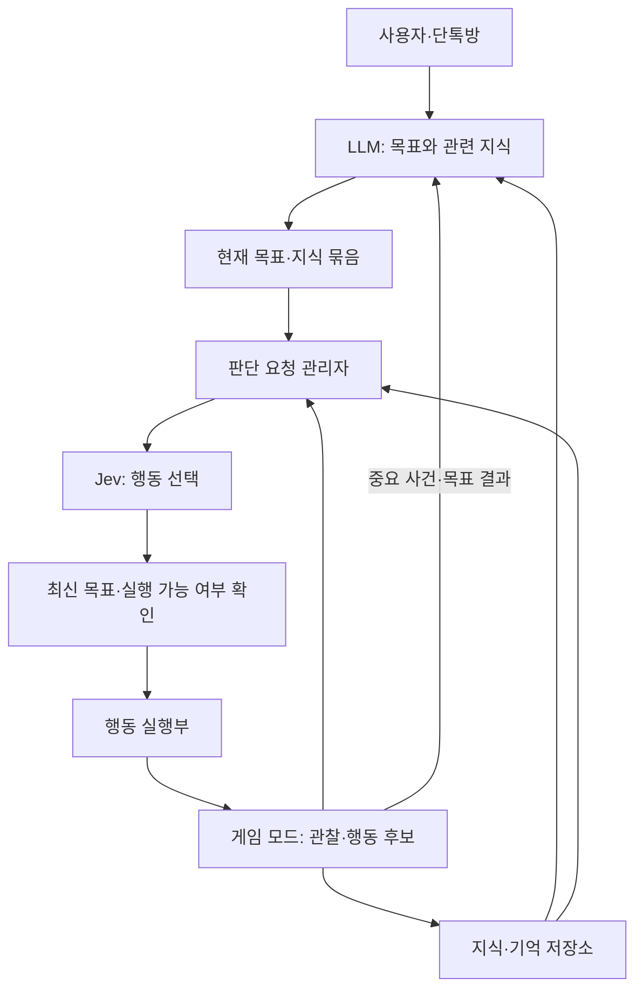

# Core Keeper AI 캐릭터 — LLM 목표와 Jev 행동 판단 설계 초안

후속 검토안: [수집 자료와 LLM 결과 점검을 반영한 행동설계 v2](2026-11-03-jev-행동설계-v2.md). 아래는 최초 초안의 기록으로 보존한다.

작성일: 2026-11-03
상태: 검토용 설계. 구현·배포·유료 호출 승인이나 실게임 검증 결과가 아니다.

## 요청과 기준

사용자 요청: “한번 설계만 해봐줄래?” 이후 기존 ‘코어키퍼-AI-캐릭터’ 작업 세션 연결을 승인했다.

이번 대화에서 사용자가 제시한 방향:
- 전체 방향과 목표는 LLM이 정한다.
- 프로그램으로 구현하려던 세부 행동 판단을 Jev에 맡기는 구상을 검토한다.
- 같은 행동을 수행하고 변화가 없을 때 호출을 줄인다. 선택지가 늘거나 사건이 발생하면 새 판단을 요청한다.
- 전투에서는 상황에 맞는 선택지를 계속 갱신하고 Jev가 행동을 판단한다.
- LLM이 관련 지식을 선별해 줄 수 있고, 전투 중에도 철수 같은 목표 변경을 할 수 있어야 한다.
- 탐색, 기억, 게임 지식 전달, 호출 비용과 지연을 함께 다룬다.

아래의 구성·중단 규칙·정보 형식은 이 방향을 연결하기 위한 제안이며 아직 구현 계약으로 확정하지 않았다.

기존 기록과의 관계:
- 2026-10-21에는 성향값 점수 방식부터 시작하고 Jev는 비교 후보로 두는 잠정 방향이 있었다. 이번 문서는 Jev를 행동 판단자로 두는 별도 설계안이며 과거 합의를 조용히 덮어쓰지 않는다.
- 현재 기록상 게임 설치와 모드 로드는 확인됐으나, AIPlayerSpike의 월드 내 STEP1~3 시험은 미완료다. 캐릭터 몸·관찰·조작 가능 범위는 아직 검증해야 한다.
- 기존 context.md는 수정하지 않는다. 과거 개발 모델·추론 강도 지정은 2026-10-31 철회 지시에 따라 현행 조건으로 적용하지 않는다.

## 설계할 주 흐름

LLM의 구리 수집 목표 → 미지 지역 탐색 → 광맥 발견 → 이동·채굴 → 몬스터 조우 → Jev 전투 → LLM 철수 지시 반영 → 귀환 → 목표 상태와 결과를 LLM에 보고.

설계 범위는 이 주 흐름과 이를 가능하게 하는 책임·정보·호출·행동 전환 규칙이다. 실제 코드, 모드 설치, API 결제, 게임 조작은 수행하지 않는다.

## 1. 책임과 구성

| 구성 | 책임 | 출력 |
|---|---|---|
| LLM 목표 관리자 | 목표·완료 조건·사용자 제약·성격에 따른 우선순위 설정, 관련 지식 선별, 큰 실패나 목표 충돌 재판단 | 목표와 지식 묶음, 목표 변경 또는 참고 의견 |
| 게임 모드 | 허용된 관찰 정보 수집, 경로 탐색과 캐릭터 조작, 실제 행동 결과 확인 | 현재 상태, 행동 후보, 완료·실패·발견 사건 |
| 기억·지식 저장소 | 게임 규칙과 관찰 기록을 구분해 저장, 관련 정보 검색 | 관련 사실, 출처·관찰 시점·확실성 |
| 판단 요청 관리자 | 호출 시점 결정, 최신 정보 묶기, 응답이 현재 목표와 실행 조건에 맞는지 확인 | Jev 요청, 적용 가능한 행동 선택 |
| Jev | 현재 목표·상황·기억·선택지를 보고 다음 행동 선택 | 제공된 후보의 ID와 확률 |
| 행동 실행부 | 선택한 행동을 지속 실행하고 중단·완료·실패를 보고 | 캐릭터 입력과 실행 결과 |

게임 모드와 외부 판단 프로그램을 분리하는 구성을 제안한다. 게임 스레드는 네트워크 응답을 기다리지 않는다. 구체적인 통신 방식은 기존 모드와 조작 경로 시험 이후 선택한다.

## 2. 목표와 제약

목표는 짧은 문장과 관찰 가능한 완료 조건을 함께 가진다. 예: ‘구리 20개 확보 후 지정 지점으로 복귀’. ‘확보’가 가방 보유량인지 새로 캔 수량인지도 목표 생성 시 정한다. 자연어 해석은 LLM이 하고 수량 확인은 프로그램이 한다.

목표 묶음에는 목표 ID·수정 번호, 목적, 완료 조건, 사용자 제약, 행동 우선순위, 성향과 관련 지식이 들어간다. 사용자 지시처럼 반드시 지킬 조건과 ‘가능하면 동료 가까이 있기’ 같은 선호를 구분한다.

사용자 제약과 명시적인 목표 제한을 위반하는 후보는 실행하지 않는다. 그 외 ‘불리해 보임’만으로 프로그램이 행동을 제거하거나 우선순위를 정하지 않는다. 전투 중 공격·우회·방어·후퇴의 판단자는 Jev다.

## 3. 유동적인 행동 후보

미리 구현한 행동에 실제 대상·위치를 연결한다. 후보마다 ID, 행동·대상, 실행 조건, 짧은 설명, 확인된 비용·효과, 완료·중단 조건을 갖는다. 불확실한 예상은 추정으로 표시하고 근거 없는 정확한 피해량을 만들지 않는다.

| 행동 계열 | 후보 예시 | 실행부가 하는 일 |
|---|---|---|
| 탐색 | 미탐색 갈림길 A 확인, 굴착 가능한 경계 B 탐색 | 지정한 구간까지 이동·굴착하고 새 관찰을 보고 |
| 이동 | 발견한 광맥 A로 이동, 동료에게 접근 | 경로를 따라 이동; 막힘·도착을 보고 |
| 작업 | 광석 A 채굴, 아이템 B 줍기 | 범위·도구 조건을 확인하고 작업 |
| 전투 | 적 A 공격, 지점 B로 짧게 이동, 현재 공격 유지, 적과 거리 벌리기 | 선택한 공격·이동 동작 수행 |
| 회복·대기 | 소지한 회복 수단 사용, 현재 위치에서 짧게 대기 | 해당 동작을 수행하고 결과 보고 |

회피·방어 같은 구체적 행동은 Core Keeper에서 해당 캐릭터와 장비로 가능한지 확인한 뒤 제공한다. 다른 게임의 방패 행동을 그대로 지원한다고 가정하지 않는다.

프로그램은 거리·통행 가능성·장비·현재 행동 상태를 계산한다. 전역의 숨겨진 광맥·적 위치를 캐릭터가 아는 정보로 쓰지 않는다. 미탐색 경계와 과거 관찰을 토대로 후보를 만든다. 후보 수를 줄일 때 중복 대상·동일 효과를 묶을 수 있으나, 전술적으로 다른 행동을 편의상 없애지 않는다.

‘현재 행동 계속’도 현재 유효할 때 명시적으로 제공한다. 적합한 후보가 없거나 반복해서 실패하면 ‘행동 후보 부족’ 상태를 보고하고 LLM에 재계획·정보 보충을 요청한다. Jev나 LLM이 런타임에 구현되지 않은 조작 코드를 만들어 실행하는 방식은 이 설계에 포함하지 않는다.

## 4. 호출 시점과 지속 행동

### 평상시

이동·채굴이 정상 진행되고 판단에 필요한 조건이 유지되면 호출하지 않는다. 다음 사건을 묶어 한 번의 판단을 요청한다.
- 현재 행동 완료·실패·진행 정지.
- 목표에 관련된 새 광맥·갈림길·적 발견.
- 후보가 추가·삭제되거나 현재 대상이 사라짐.
- 체력·재고·위험 등으로 같은 선택지의 의미가 크게 바뀜.
- LLM 목표 또는 강제 조건 변경.

예를 들어 적이 한 걸음 움직였다는 이유만으로 평상시 요청을 늘리지 않는다. 의미 있는 변화의 기준은 규칙으로 정의하되 ‘후퇴할 체력’을 프로그램이 결정하는 규칙과 구분한다. 관찰과 진행 확인은 호출하지 않는 동안에도 계속한다.

### 전투

현재 상태와 후보를 계속 갱신한다. 캐릭터당 Jev 요청 하나를 진행하고, 대기 중 발생한 사건은 최신 상태 하나에 모은다. 응답 후 최신 상태로 다음 판단을 요청하되, 동일한 결정을 유지해도 되는 상태라면 사건이 생길 때까지 쉬게 할 수 있다. 고정 0.1초 응답을 전제로 하지 않는다.

응답을 기다리는 동안 선택된 행동은 정해진 완료·중단 조건과 유효 기간 안에서 계속된다. 공격 주기나 경로 추적은 실행부가 담당한다. Jev가 지정하지 않은 다른 적으로 자동 전환하거나 후퇴 전술을 새로 고르는 일은 하지 않는다.

짧은 이동 명령, 공격 유지 등 기다리는 동안 수행할 수 있는 행동을 사용한다. 같은 행동·대상을 다시 골랐다면 동작을 처음부터 재시작하지 않고 유지한다. 행동 전환은 게임이 허용하는 중단 시점에 일어난다.

Jev가 적 접근·공격·거리 벌리기·퇴각을 결정하는 것을 초안의 기본으로 한다. 프로그램이 별도 판단으로 자동 회피·자동 후퇴하는 것은 사용자가 말한 ‘전투를 온전히 맡김’과 달라질 수 있으므로 기본에 숨겨 넣지 않는다. 그런 반사 행동을 추가할지는 실측 후 별도 선택 사항이다. 이 기본에서는 API 지연 때문에 회피에 실패할 수 있다.

## 5. 오래된 판단과 LLM의 전투 중 개입

각 Jev 요청에는 목표 수정 번호, 관찰 시점, 후보 ID·대상 정보를 붙인다. 응답 적용 시 현재 목표와 대상·행동 조건을 확인한다. 게임 상태가 조금 변했다는 이유로 전부 버리지는 않고, 선택한 행동의 전제가 유지되는지 확인한다. 예를 들어 같은 적이 조금 움직였으면 현재 위치를 따라 실행할 수 있지만, 죽었거나 접근 불가능하면 적용하지 않는다.

LLM도 판단을 시작한 목표 수정 번호와 관찰 시점을 받는다. 오래된 LLM 결과가 최신 사용자 지시를 덮어쓰지 않게 한다. ‘적이 모두 죽었다’ 같은 완료 사실은 모델 의견이 아니라 최신 게임 관찰로 확인한다. 전제가 사라진 오래된 계획은 보류하고 재판단한다.

LLM은 전투의 매 판단에 참여하지 않는다. 적 증원, 큰 피해, 진행 불가, 사용자 지시 등 중요한 사건을 모아 별도로 판단하며 Jev 전투를 막지 않는다.

| LLM 메시지 | 처리 |
|---|---|
| 목표 변경: ‘채굴을 중단하고 기지로 철수’ | 목표 수정 번호를 올리고 기존 작업을 중단·보류 상태로 둔다. 이전 목표의 Jev 응답은 적용하지 않는다. 새 목표로 최신 상황을 판단한다. |
| 참고 의견: ‘동쪽에 적이 많아 위험할 수 있음’ | 출처와 시점을 포함해 다음 Jev 입력에 반영한다. 그 의견만으로 현재 행동을 강제 전환하지 않는다. |
| 일시 지시: ‘전투에서 벗어나 회복한 뒤 수집 재개’ | 재개 조건을 목표에 기록한다. 조건을 관찰로 확인한 뒤 원래 목표를 다시 활성화한다. |

‘철수’의 완료 조건과 허용되는 방어·길 확보 행동도 목표에 명시한다. 철수 중 필요한 공격은 허용할 수 있지만, 적을 추격해 전투 목적을 되살리지 않는다. ‘공격 금지’라는 명시적 지시가 있으면 공격 후보를 제한한다.

목표 변경 시 진행 중 요청은 취소를 시도하되, 취소된 요청의 응답이 도착해도 수정 번호로 차단한다. 단일 요청 원칙 아래 취소 완료·응답·타임아웃 이후 최신 요청을 보낸다. 목표 갱신 즉시 새 지시와 충돌하는 지속 행동은 중단 가능한 시점에 멈추며, 그 공백의 이동 전술을 프로그램이 임의로 결정하지 않는다.

Jev 자체도 현재 목표의 제약 안에서 후퇴를 고를 수 있다. 잠깐 물러나기와 전체 수집 목표 폐기는 서로 다른 결과다.

## 6. 지식과 기억을 전달하는 방법

정적 게임 규칙, 실제 관찰·지도·재고, 경험 요약·성향을 구분한다. 기록에는 관련 대상과 장소, 관찰 시점, 사실인지 추정인지, 유효 여부를 둔다. 캐릭터별 관찰 기억과 공유 받은 정보도 구분한다.

LLM은 목표가 생기거나 큰 상황이 바뀔 때 필요한 지식과 우선순위를 선별한다. 전투 중에는 이 지식 묶음을 재사용하고 프로그램이 적·무기 ID로 필요한 사실을 추가 조회하며 최신 상태를 직접 갱신한다. 새로운 적에 관한 사실이 저장소에 없으면 ‘모름’으로 전달하고 LLM에 비동기 보충을 요청한다. 전투를 정보 생성 완료까지 묶어 두지 않는다.

한 번의 Jev 입력은 다음으로 제한한다.
1. 활성 목표·제약·관련 성향.
2. 현재 판단에 필요한 게임 규칙.
3. 최신 관찰·현재 행동·실제 진행량.
4. 관련 장소 기억·최근 실패·직전 선택과 그 결과.
5. 현재 행동 후보와 각 후보를 비교하는 데 필요한 사실.

정보가 우리 저장소에 남아 있어도 Jev에게 저절로 기억되지는 않는다. 판단에 필요한 내용은 매 호출에 포함한다. 지식그래프는 관련 정보 검색에 쓰며 그 자체가 토큰 절약이나 모델 메모리는 아니다. 초기에는 ID로 연결한 데이터표·장소 기록만으로 같은 인터페이스를 만들고, 관계 검색이 복잡해질 때 그래프로 확장하는 구성을 제안한다.

전투의 추가 조회는 프로그램에서 먼저 수행해 한 번에 전달한다. 여유 있는 탐색·제작 판단은 필요 정보 요청 → 상세 검색 → 재판단의 두 단계도 가능하다. 총 토큰은 실제 요청 usage로 집계한다.

## 7. 실패·연결 지연·다양성

- 호출이 실패하면 유효한 현재 행동은 허용된 시간까지만 유지한다. 유지할 행동이 없거나 유효 기간이 끝나면 새 입력을 중단하고 모델 응답 대기 상태를 기록한다. 멈춤이 생존을 보장하지는 않는다. 전술을 대신 정하는 폴백은 이번 기본안에 포함하지 않는다.
- 반복 실패·제자리 왕복·목표 진전 없음은 기록해 Jev에 제공하고, 지속되면 LLM 재계획을 요청한다. 실패한 행동을 영구 제거하지 않고 실패 원인과 재시도 조건을 구분한다.
- 초기에는 Jev의 기본 선택을 적용하고 확률 전체를 기록한다. 무작위 추첨은 선택 사항이며 기본으로 넣지 않는다. 동일 입력의 결과 변동이나 사람다운 행동은 보장하지 않는다.
- 자연스러운 움직임은 행동의 연속성, 전환 시점, 실제 게임 조작 품질에도 달려 있다. 모델이 고른 동작과 프로그램이 수행한 동작을 구분해 기록한다.

## 8. 대표 흐름으로 연결 확인

| 단계 | 사건 | 판단·실행과 남는 상태 |
|---|---|---|
| 1 | LLM: 구리 20개 확보 후 기지 복귀 | 목표 v1 생성, 관련 채굴·탐색 지식 준비 |
| 2 | 광맥 위치를 모름 | 프로그램이 관찰된 미탐색 갈림길을 후보로 제공, Jev가 동쪽 탐색 선택 |
| 3 | 동쪽으로 이동 | 실행부가 이동을 유지하고 관찰. 변화가 없으면 추가 호출 없음 |
| 4 | 구리 광맥 발견 | 사건으로 호출, Jev가 접근·채굴을 선택. 실제 보유량을 관찰해 진행 갱신 |
| 5 | 몬스터 접근 | 최신 후보로 Jev 판단. 채굴 지속·공격·우회·거리 벌리기 등을 비교 |
| 6 | 전투 시작 | Jev가 행동 갱신, 실행부는 기다리는 동안 유효한 기존 동작 지속 |
| 7 | 증원으로 LLM이 철수 지시 | 목표 v2 적용. v1 응답의 늦은 돌진 명령은 폐기; 충돌하는 동작 중단 |
| 8 | Jev가 철수 경로와 방어 행동 선택 | 기지 방향으로 이동하며 관찰. 길이 막히면 다시 선택 |
| 9 | 기지 도착 | 최신 관찰로 철수 완료 확인. 구리 수집은 보류로 남겨 자동 재개하지 않음 |
| 10 | LLM에 결과 보고 | 확보량·중단 이유·발견한 광맥·전투 결과를 전달. 다음 목표는 새 판단으로 정함 |

위 표는 설계상 사건 추적이며 실행 시험 결과가 아니다. 철수 개입이 없었다면 전투 종료 후 유효한 원래 목표에 따라 채굴 재개·회복 등을 Jev가 고르고, 수집과 복귀 완료를 관찰해 LLM에 보고한다.

## 9. 구현 전에 확인할 것

첫 실게임 검증 단위는 위 주 흐름을 한 캐릭터로 연결하는 것이다. 캐릭터 몸·게임 상태 관찰·이동·공격·중단·가방 수량 확인이 실제로 가능한지 먼저 확인해야 한다.

이후 확인할 증거는 다음과 같다.
- 평상시 변화 없는 이동·채굴에서 중복 호출이 발생하지 않는가.
- 적 발견과 행동 실패가 새 판단으로 이어지는가.
- 답을 기다리는 동안 게임과 행동 실행이 유지되는가.
- 실제 요청 지연의 중앙값·느린 구간(p95), 관찰부터 행동 적용까지의 시간, 호출량·토큰·비용.
- 철수 지시 후 이전 목표의 응답이 동작을 덮어쓰지 않는가.
- 회피·거리 조절이 API 지연을 감당하는가. 실패하면 짧은 동작 설계 변경, 프로그램 반사 행동 허용, 다른 판단 수단 중 사용자에게 중요한 선택을 다시 제시한다.

현재 확정하지 않는 항목: 구체적인 전투 판단 주기, 자동 반사 행동 허용 범위, 캐릭터 수와 비용 한도, 몸 구현 경로, 지식그래프 저장 기술. 입력·관찰·상태 전환부터 구체화하되 실측 없이 0.1초 반응을 약속하지 않는다.

## 참고 근거

- [Jev Choice 공식 문서](https://docs.typesafe.ai/primitives/choice): 선택지별 확률과 기본 최대 확률 선택.
- [Jev 공식 모델 문서](https://docs.typesafe.ai/models): 토큰 과금·입력과 컨텍스트 규칙. 실제 적용 시 최신 조건 재확인.
- [jevcraft](https://github.com/mrubens/jevcraft), [전투 반응 코드](https://github.com/mrubens/jevcraft/blob/main/src/shot-reflex.js): 게임 상황으로 후보를 구성해 Jev가 전투 행동을 선택하는 참고 사례. 이 프로젝트의 프로그램 반사 동작을 본 설계의 승인으로 해석하지 않는다.
- [JEV-Star](https://github.com/sc2musa/Jev_Star): LLM 계획과 Jev 선택 분리 사례. 보고된 실시간 운영 응답 중앙값은 약 0.375~0.421초이며 Core Keeper에서의 성능 보장이 아니다. 미세 조작 실험은 고정 스텝으로 게임을 멈추는 조건이므로 실시간 반응의 증거로 혼용하지 않는다.
- [Jev Town](https://github.com/NevaMind-AI/JevTown): Jev 행동 선택과 LLM 대화·기억 분리 사례.

사례들은 문서·일부 소스 조사 근거이며 이 작업에서 실행하거나 재현하지 않았다.
