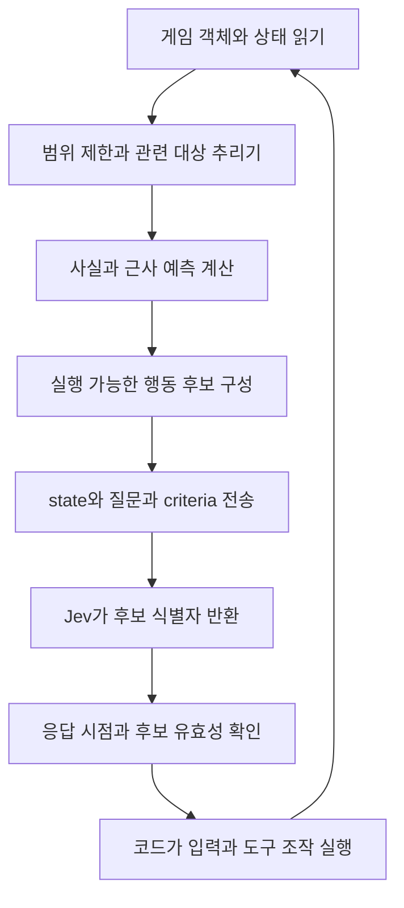

# TerraBlind의 Jev 관측과 행동 선택 분석

코어키퍼 전투 개선을 위해 TerraBlind가 **게임 상태를 수집하고, 판단에 쓸 사실과 예측으로 가공하고, 가능한 행동을 Jev에 제시한 다음, 선택 결과를 실제 조작으로 옮기는 과정**을 분석한다. 전투 외에 광맥 채굴·채집·벌목·탐색도 비교한다.

핵심은 정보량 자체보다 **선택지와 그 결과를 연결하는 방식**이다. TerraBlind는 적의 현재 좌표만 주는 데서 그치지 않고, 일부 경로에서는 접근 속도·충돌 예상 시간·방향별 여유 공간·탄도·이동 후 거리 변화 등을 계산해 선택지와 함께 제공한다. 한편 모든 기능이 Jev로 제어되는 것은 아니다. 일반 몬스터 대응과 광맥 채굴 등에는 코드가 직접 선택하는 경로가 남아 있다.

## 읽는 순서

| 문서 | 찾을 수 있는 내용 |
|---|---|
| [01 전투](01-전투.md) | 보스·일반 몬스터·PvP별 실제 호출 경로, 관측 필드와 단위, 위험 계산식, 후보 생성, 요청 형식, 응답·실행·재판단, 한계 |
| [02 채굴과 탐색](02-채굴과탐색.md) | 광맥 채굴·일반 채집·벌목·이동 막힘에서 코드와 Jev가 각각 맡는 일, 실제로 전송되는 상태와 선택지 |
| [03 전투 성능과 후기](03-전투성능과후기.md) | 제작자 시연, 커뮤니티 반응, 직접 설치 후기의 확인 범위, 성능 주장에 적용할 조건 |
| [04 코어키퍼 참고사항](04-코어키퍼-참고사항.md) | 기존 전투 개선 계획과 연결되는 아이디어, 그대로 옮기면 기존 원칙과 달라지는 부분, 구현 전 확인할 조건 |
| [05 검토 기록](05-검토.md) | 독립 코드·출처 대조, 발견한 세부 정정과 반영 확인 |

## 분석 기준

- TerraBlind 저장소: [Reisenbug/TerraBlind](https://github.com/Reisenbug/TerraBlind).
- 코드 기준: [`0859ca29aedea7bb48324c68eaece35b629c6d37`](https://github.com/Reisenbug/TerraBlind/tree/0859ca29aedea7bb48324c68eaece35b629c6d37), 커밋 시각 2026-11-01 20:44:31 +0800.
- 로컬 참고 사본: `C:\Dev\_scratch\terrablind-review-20261104`.
- 코어키퍼 비교 기준: 로컬 `CoreKeeperModSDK`의 `3c3adbe` 및 2026-11-04 전투 현황 진단·개선 계획. 다른 작업 브랜치에서 진행 중인 리팩토링의 완료 결과를 가정하지 않는다.
- 확인 수준: 호출자부터 소비자까지 정적 코드 추적. 게임 실행·Jev 요청 재현·전투 성능 측정은 이번 작업에 포함하지 않았다. 예시로 재구성한 요청은 실제 실행 로그와 구분한다.
- 이번 결과는 참고 분석이다. 사용자 프로젝트의 코드·전투 정책·기존 개선 계획을 변경하지 않는다.

## 기능별로 Jev의 역할이 다르다

| 경로 | 상태를 바탕으로 선택하는 주체 | Jev에 맡긴 핵심 |
|---|---|---|
| 보스 제어 `Dodge` | Jev + 코드 실행기 | 가능한 방향·이동 강도를 묶은 행동 하나 |
| 일반 자동 전투 `Combat` | 현재 경로는 코드 | 옛 `JevCombat` 질문 정의를 현재 호출로 오인하면 안 됨 |
| `fight` 도구의 국소 회피 | 코드 | 후보 움직임의 위험을 코드가 평가하고 선택 |
| PvP `PvpDuel`·`PvpTactics` | Jev + 코드 실행기 | 이동·구체 무기·조준 방식·발사 여부를 묶은 계획 |
| 광맥 채굴 `mine_vein` | 상위 LLM이 도구를 요청한 뒤 코드 루프 | 광맥 내부의 채굴 선택을 Jev가 하지 않음 |
| 일반 채집 `gather`·방향 탐색 | 코드 실행 루프 | 이 경로의 선택을 Jev가 한다고 볼 근거 없음 |
| 벌목 `chop_wood` | Jev + 코드 실행기 | 후보 나무 중 다음 대상 또는 중지 |
| 막힘 판단 `JevTriage` | 현재는 baseline 코드 | 질문 설계는 있으나 실제 Jev 호출은 연결되지 않음 |

각 항목의 호출 근거와 경계는 01·02 문서에 있다. README의 설명과 클래스 이름만으로 이 표를 만들지 않았다.

## 관측부터 실행까지의 공통 구조

이 그림은 실제 Jev 경로의 공통 구조다. 광맥 채굴처럼 E·F를 거치지 않고 코드가 다음 작업을 고르는 기능도 있다. 보스·PvP·벌목은 상태 표현, 후보 크기, 신뢰도 처리, 중단·재판단 조건도 서로 다르다.

## 코어키퍼에 특히 중요한 발견

1. **원시 상태와 선택지의 결과 설명을 함께 제공한다.** 적이 어느 쪽에 있는지와, 특정 이동이 그 적·투사체에 어떻게 가까워지는지는 서로 다른 정보다. 후자를 코드가 계산해 주면 모델은 비교 판단에 집중할 수 있다.
2. **예측은 근사이며 실행 보장은 아니다.** 보스 경로의 충돌시간·0.6초 변위·투사체 통로 판정에는 단순화가 있다. 예측치가 어떤 가정으로 계산됐는지까지 이해해야 참고할 수 있다.
3. **실제로 전달되는 정보만 모델의 근거다.** 게임에서 읽은 필드나 내부 snapshot에 저장된 필드가 모두 요청에 들어가는 것은 아니다. 현재 보스 상태 직렬화에는 이전 행동 등 일부 snapshot 필드가 빠진다.
4. **후보를 좁히는 코드도 전술에 영향을 준다.** 물리적으로 불가능한 행동뿐 아니라 벽 주변 여유 공간 같은 기준으로 후보를 막으면, 판단 권한 일부가 후보 생성기로 이동한다.
5. **빠른 응답만으로는 충분하지 않다.** 관측 시각·요청 지연·실행 시각·행동 종료 시각과 그 사이의 환경 변화까지 연결해서 봐야 한다.
6. **공개 시연과 독립 검증을 구분한다.** 제삼자가 반복 사용한 성능 후기는 이번 검색에서 확인되지 않았다. 소스 구조의 참고 가치와 실제 전투 안정성의 입증 수준은 다르다.

## 이전 대화에서 좁혀야 할 설명

앞선 보스 코드 중심 비교를 모드 전체의 동작으로 읽으면 부정확하다. 보스는 이동 중심 선택을 하지만 PvP는 공격을 포함한 결합 후보를 선택하고, 일반 몬스터 대응은 별도의 코드 판단 경로가 있다. 채굴도 광맥 채굴과 벌목이 다르다. 또한 README의 과거 다중 질문 구조와 현재 `action` 선택 구조를 구분해야 한다.

이 프로젝트가 전투를 잘 수행한다는 평가는 제작자 시연 범위를 넘겨 단정할 수 없다. 사용자 프로젝트의 장기기억·맥락 있는 소통 목표와는 별개로, 이번 문서는 관측과 선택지 설계의 구현 근거를 제공한다.
