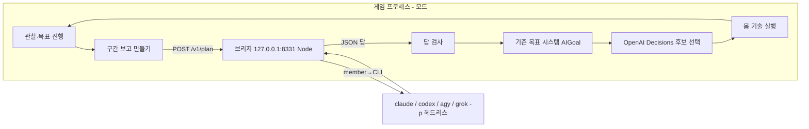

# 위쪽 LLM — 구독 CLI로 목표 정하기 설계 초안

작성일: 2026-11-04. 상태: 설계 초안(사용자 검토용). 코드·게임·단톡방은 바꾸지 않았다.

사용자 결정(2026-11-03): 위쪽 LLM은 API 키가 아니라 구독을 쓴다. 이 PC에 로그인된 Claude·ChatGPT(Codex)·Gemini(agy)·Grok CLI를 단톡방처럼 헤드리스로 부른다. 행동설계 v2의 "Jev"는 지금 OpenAI Decisions(아래쪽 판단)다.

참고: [행동설계 v2](2026-11-03-jev-행동설계-v2.md) 2·3·7·8·9장, [행동판단 연결 구현](2026-11-03-행동판단-연결-구현.md), [파들어가기·탐색기억](2026-11-03-파들어가기-탐색기억.md).

## 0. 추천 한눈에

- 게임 모드 → **localhost HTTP 브리지(Node, 새 프로그램)** → 멤버의 CLI. 단톡방 서버는 고치지 않는다.
- 브리지는 단톡방의 `lib/agents/adapters.mjs`를 **읽기 전용으로 가져다 쓴다**(CLI 찾기·로그인 확인·도구 막기·플래그를 그대로 씀). 작업 폴더는 브리지 자기 폴더를 쓴다.
- LLM은 **구간 보고 하나에 목표 하나**를 답한다. 지금 있는 목표 종류(모으기·탐험·따라가기)만 쓰고, 모드가 실제 사실로 검사해 기존 목표 시스템에 넣는다.
- 호출은 **목표가 끝나거나 멈출 때, 쓰러졌다 일어날 때**만 한다. 캐릭터마다 한 번에 하나. 기다리는 동안 몸은 지금 목표로 계속 움직이고, 목표가 없으면 서 있다.
- 첫 조각: **Claude 한 명, `/ai goal 알아서`로 켜고, 보고 → 목표 → Decisions 실행 → 완료 → 다음 보고**를 실게임에서 두 바퀴 돌린다.
- 단톡방과 같은 인물로 할지(기억·대화 공유)는 **사용자 결정**이다. 첫 조각은 이름만 같은 게임 전용으로 시작하고, 나중에 붙일 자리를 남긴다.

---

## 1. 확인한 사실

### 1.1 단톡방이 CLI를 부르는 방법

모든 호출은 한 번 실행하고 끝나는 프로세스다. 단톡방은 세션을 이어 쓰지 않는다. 매번 안내문(brief)과 이번 턴 전체를 다시 보낸다. 대화가 이어지는 것은 프로그램이 넣어 주는 최근 대화 40개와 개인 메모 덕분이다(README.md:106).

| 멤버 → CLI | 명령·주요 플래그 | 입력 | 출력 읽기 | 세션 | 근거 |
|---|---|---|---|---|---|
| Claude → `claude` | `-p --model <m> --tools "" --strict-mcp-config --no-session-persistence --setting-sources "" --system-prompt-file system.md [--effort]`, `--output-format json` | 안내문은 파일, 턴은 stdin | JSON의 `type:"result"` → `result`. `is_error`면 실패 | 저장 안 함 | lib/agents/cli/claude.mjs:38-44, 108-123 |
| ChatGPT → `codex` | `exec -m <m> -c model_reasoning_effort=… --skip-git-repo-check --ignore-user-config --ephemeral -s read-only --disable shell_tool … --json -o <파일> -` | 안내문+턴을 stdin | 답은 `-o` 파일. 토큰·오류는 stdout JSON 이벤트(`turn.completed`, `error`, `turn.failed`) | ephemeral | codex.mjs:12-34, 63-79 |
| Grok → `grok` | `--prompt-file prompt.txt -m <m> --effort low --disallowed-tools <전부> --permission-mode dontAsk --output-format json --no-subagents --disable-web-search --cwd <폴더>`. 환경변수로 Claude 훅·MCP 읽기 끔 | 프롬프트 파일 | JSON의 `text` | 이어 쓰지 않음 | grok.mjs:15-31, 66-99 |
| Gemini → `agy` | `--model <m> --input-format stream-json --output-format stream-json --print-timeout <초>s`. TEMP를 빈 폴더로, 자동 업데이트 끔 | stdin 한 줄(stream-json). 명령줄은 32767자 제한 때문에 안 씀 | `event:"result"`의 `response` | 매 턴 새 대화(이어 쓰면 토큰이 쌓여서 10-23에 그만둠) | agy.mjs:13-26, 41-45, 56-99 |

공통 동작:

- **실행:** `spawn` + 시간 제한. 넘으면 `taskkill /T /F`로 프로세스 트리를 죽인다. 결과는 `{code, stdout, stderr, ms, timedOut}`(lib/agents/run.mjs:29-33, 39-70). npm의 `.cmd`는 셸 없이 못 띄우므로 실제 exe를 찾아 쓴다(adapters.mjs:22-30).
- **CLI 위치가 바뀜:** Codex 데스크톱 앱이 업데이트하면서 옛 codex.exe를 지운다. 없어진 경로는 다시 찾는다(adapters.mjs:57-68).
- **시간 제한:** 보통 턴 150초(`turnTimeoutSec`), 진심모드 360초(lib/server/config.mjs:28·32, adapters.mjs:110).
- **동시 실행:** 방 전체에 동시에 최대 3턴(`maxInFlight`, scheduler.mjs:70). 한 멤버는 한 번에 한 턴만 한다(`busy`, scheduler.mjs:39, turn.mjs:138·220). 같은 멤버 작업 폴더에 `system.md`·`prompt.txt`를 고정 이름으로 쓴다(claude.mjs:110, grok.mjs:83). 그래서 같은 작업 폴더로 두 호출을 동시에 하면 서로 덮어쓴다.
- **실패 후:** 20초·40초·80초… 최대 5분 쉰다(turn.mjs:207-212).
- **로그인:** Grok·agy는 로그아웃 상태에서 실행되면 브라우저 로그인 창을 스스로 연다. 그래서 먼저 로그인을 확인한다(LoginGate, logins.mjs:10-14, adapters.mjs:102).
- **사용량:** 모델 호출 없이 읽는다. claude `-p /usage`, codex `app-server`의 `account/rateLimits/read`, grok ACP의 `_x.ai/billing`, agy `-p /usage`. 결과는 `data/usage.jsonl`에 쌓인다. 숫자는 계정 전체 기준이다(usage.mjs:1-9).
- **API 키 차단:** 서버는 시작할 때 `ANTHROPIC_API_KEY`를 지운다. 이 키가 있으면 `claude -p`가 구독 대신 API로 청구하기 때문이다(server.mjs:30-33).
- **답 파싱:** 답 안의 첫 번째로 괄호가 맞는 JSON 객체를 꺼낸다. 코드 울타리(```)는 무시한다(prompt.mjs:499-510). 버린 답은 종류별로 센다: empty·no-json·broken-json·unknown-fields(prompt.mjs:512-526, dropKind 515).
- **멤버 → CLI 대응:** claude→claude, gpt→codex, grok→grok, gemini→agy(members.mjs:26·40·54·68). 성격·말투는 정하지 않고 대화에서 생긴다. 기억은 멤버마다 `data/notes/<id>.md` 한 파일(최대 4000자)이다(members.mjs:1-4, memory/notes.mjs:1-9).

### 1.2 사용량 한도와 오류가 드러나는 모습

로그에서 본 것들이다(`data/logs/*.log`, `tokens.jsonl`, 2026-10-23~11-03).

| 종류 | 드러나는 곳 | 본 사례 |
|---|---|---|
| Grok 사용량 소진 | stdout JSON `{"type":"error","message":"… 402 Payment Required: Grok Build usage balance exhausted"}` | grok.log에 120줄(10-26~10-28) |
| Codex 실패 | stdout `--json` 이벤트의 `error`/`turn.failed`(stderr엔 안 나옴). 계정 한도는 `spendControlReached`·`rateLimitReachedType` | 시간 초과 12회 |
| Codex exe 사라짐 | `spawn … codex.exe ENOENT` | 106회(지금은 다시 찾기로 고쳐짐) |
| agy | `status`가 SUCCESS가 아님. print timeout이면 일부 출력만 옴. 명령줄이 길면 ENAMETOOLONG | print timeout 3회, ENAMETOOLONG 77회(지금은 stdin으로 고쳐짐) |
| Claude | `is_error` 결과. 한도 도달 문구는 로그에서 보지 못함 | 실패 2회 / 2830회 |

실패율(tokens.jsonl, 10-23 이후): Claude 2/2830, Gemini 2/2168, ChatGPT 44/2445, Grok 43/2183.

**지금 사용량**(usage.jsonl 마지막 기록, 11-03 16:55 UTC):

| CLI | 주간 사용 | 주간 초기화(서울) |
|---|---|---|
| Claude | 35% | 11-08 15:00 |
| Codex | **96%** | 11-04 18:37 |
| Grok | **99%** | 11-04 20:36 |
| agy | 10.6%(5시간 창 0%) | 11-09 21:09 |

**단톡방 호출 100회당 주간 사용률**(사용량 기록 사이의 증가분 ÷ 같은 구간의 호출 수, 호출당 입력 약 3.4만~4.1만 토큰):

| CLI | 주간 % / 100회 | 메모 |
|---|---|---|
| Claude | 6.4 | 위 한계값. 개발 작업 등 방 밖 사용도 같이 셈 |
| Codex | 4.9 | |
| agy | 13.1(5시간 창 17.2) | |
| Grok | 4.6 | |

계산 스크립트: `C:\Users\<USER>\AppData\Local\Temp\claude\c237366b8a8ea80b\bda115de-8b8e-4222-b977-4420fd4c7cb3\scratchpad\pct.mjs`

### 1.3 지연 실측

**단톡방 로그**(tokens.jsonl, 성공한 호출, 입력 약 3.4만~4.6만 토큰):

| 멤버·모델(강도) | 횟수 | 중앙값 | p90 | p99 | 최대 |
|---|---|---|---|---|---|
| Claude opus-5-5(low) | 2830 | 4.7초 | 8.7초 | 16.3초 | 23.8초 |
| ChatGPT gpt-6.1-sol(low) | 2445 | 6.6초 | 11.7초 | 26.2초 | 110.9초 |
| Gemini 3.8-flash-low | 2168 | 13.7초 | 15.4초 | 19.3초 | 156.9초 |
| Grok 4.7(low) | 2183 | 16.7초 | 33.3초 | 55.2초 | 106.1초 |

진심모드(높은 강도)는 건수가 적다(4~7회). 중앙값은 Claude high 21초, Gemini high 30초, GPT astra medium 17초, Grok high **116초**(최대 198초)였다.

계산 스크립트: `…\scratchpad\lat.mjs`(위와 같은 scratchpad 폴더).

**아주 작은 "OK" 호출 한 번씩**(이번에 직접 잼, 단톡방과 같은 플래그). Codex와 Grok은 주간 사용량이 96%·99%라 부르지 않았다.

| CLI | 총 시간(프로세스 시작~끝) | 모델 쪽 시간 | 입력 토큰 | 메모 |
|---|---|---|---|---|
| claude opus-5-5 low | 3.7초 | 1.8초(API 1.4초) | 약 540 | **이 셸에는 `ANTHROPIC_API_KEY`가 있었고, CLI가 "API 키가 claude.ai 로그인보다 우선"이라고 경고함.** 이 호출은 구독이 아니라 API로 청구됐을 가능성이 높다(보고된 비용 $0.0028). |
| agy gemini-3.8-flash-low | 8.3초 | 2.9초 | **6924**(agy가 자체 시스템 문구를 붙임) | 프로세스 준비에만 약 5초 |

### 1.4 모드 쪽 사실

- **판단 호출 방식:** UnityWebRequest POST로 부르고, 매 틱 `isDone`을 확인한다. 게임 스레드를 막지 않는다(AIDecisions.cs:510-516, 374-376). 요청은 한 번에 하나, 시간 제한 10초다(AIDecisions.cs:28-41).
- **목표:** `GoalKind { None, Gather, Explore, Follow }`. 모으기는 `item`(ObjectID)·`count`·`startCount`가 있고, 시작 뒤 가방에서 늘어난 개수로 완료를 판정한다(AIDecisions.cs:61-71, 356-367). 목표를 바꾸면 `Revision++`하고 진행 중인 요청을 버린다(AIDecisions.cs:190-197, 277-280). 목표 설정은 지금 `/ai goal` 처리 안에만 있다(AIDecisions.cs:235-284). 품목 별칭은 흙·구리·주석·나무이고, 그 밖에는 ObjectID 이름을 쓴다(AIDecisions.cs:287-298).
- **목표가 끝나는 곳(=보고할 때):** 완료(356-367), 모을 방법 없음(443-452), 탐험할 곳 없음(454-462), 기다리기만 5번 남음(466~). 쓰러짐과 다시 일어남은 따로 감지한다(335-353). 끝나는 이유는 이미 한국어 문장(`why`)으로 만들어진다.
- **한 캐릭터 전제:** `AiName="Claude"`, `AiCharacterGuid` 상수(AIPlayerSpikeMod.cs:48-49). 플레이어 guid는 `Hash("AIPlayerSpike:"+월드+":"+이름)`(600). 캐릭터 파일은 `AIPlayers/<월드>/<이름>.json`(1321), 참여 설정은 `AIPlayers/<월드>/settings.json`(1269), 탐색 기억은 `AIPlayers/<월드>/memory.json`(AIExplore.cs:66, 캐릭터 구분 없음). `AIBrain`·`AIBody`·`AIMemory`는 모두 static이고, 얇은 클라이언트는 127.0.0.1:7778 하나다.
- **HTTP 설정:** SDK 프로젝트는 Unity 6000.0.59f2, `insecureHttpOption: 0`(ProjectSettings.asset:969, http 허용 안 함)이다. 게임 실행 파일의 설정과 localhost 예외 여부는 **확인 안 함**. 지금 쓰는 주소는 https다.
- **포트:** 단톡방 서버는 지금 127.0.0.1:8321에서 돌고 있다(netstat). 게임 쪽은 7777·7778을 쓴다.

---

## 2. 해석

- **지연:** 게임 보고는 단톡방 턴(약 4만 토큰)보다 훨씬 작다. 예상은 2천~6천 토큰이다. 그래도 프로세스 준비 시간이 있다(Claude 약 2초, agy 약 5초). 그래서 한 호출은 **대개 4~20초, 꼬리는 1분 가까이**로 잡는다. Grok 높은 강도는 2분이 넘을 수 있으니 게임에서는 쓰지 않는다. 아래쪽 판단(Decisions, 0.2초)과 달리 몇 초~수십 초는 늦어도 되는 일에만 쓴다. 행동설계 v2 §8(비동기 재판단)과 맞는다.
- **사용량:** 단톡방과 게임은 **같은 계정 한도를 나눠 쓴다.** 지금 Codex·Grok은 이미 한도 근처다. 게임 호출은 작으니 회당 소모도 적을 것으로 보지만, 구독 한도가 토큰에 비례하는지는 확인하지 못했다. agy는 고정으로 약 7천 토큰이 붙어서 줄어드는 폭이 작다. 캐릭터 하나가 시간당 6~15회를 부르면, 단톡방 크기 호출로 쳐도 주간 한도의 몇 %다. 문제가 되는 것은 단톡방이 함께 돌 때 한도에 먼저 닿는 멤버(Codex·Grok)다.
- **API 키 위험:** 이 PC의 사용자 환경에는 `ANTHROPIC_API_KEY`가 있다. 브리지가 이 키를 지우지 않으면 "구독으로 부른다"는 결정이 조용히 깨진다. 단톡방은 이미 이 문제를 겪고 막아 두었다.
- **단톡방 서버를 그대로 쓰지 않는 이유:** 단톡방에는 게임용 입구가 없다. 만들려면 단톡방을 고쳐야 하고, 그것은 다른 주제다. 단톡방 작업 폴더를 함께 쓰면 고정 파일 이름 때문에 프롬프트가 섞인다. 반면 CLI를 부르는 부분(adapters)은 이미 서버와 떨어져 있어서 가져다 쓸 수 있다.

---

## 3. 설계

### 3.1 누가 무엇을 부르나



- **모드:** 언제 보고할지 정하고, 보고를 만들고, 답을 검사해서 적용한다. 진행 판정도 모드가 한다. 사실을 판정하는 권한은 모두 모드에 있다(v2 §2·§3).
- **브리지:** 멤버에 맞는 CLI를 부르고, 답에서 JSON을 꺼내 모양만 확인해 돌려준다. 게임 사실은 모른다. 사용량 오류를 종류별로 나눠서 알려 준다.
- **LLM:** 다음 목표 하나와 짧은 이유, 한 줄 말을 정한다. 이동·공격은 정하지 않는다.

### 3.2 통신 방식

| 방식 | 장점 | 단점 | 판단 |
|---|---|---|---|
| **localhost HTTP 브리지(새 Node 프로그램)** | 모드에 이미 있는 UnityWebRequest 방식 그대로. 단톡방을 고치지 않음. 나중에 단톡방이 같은 API를 열면 주소만 바꾸면 됨 | 프로그램 하나를 더 켜야 함. 게임이 http를 막을 수 있음(1.4, 미확인) | **추천** |
| 단톡방 서버에 입구 추가 | 기억·사용량·동시 실행을 한곳에서 관리 | 단톡방 개조가 필요함(다른 주제). 방이 꺼져 있으면 못 씀 | 나중 목표(3.7의 C) |
| 파일 주고받기(`AIPlayers/bridge/req-*.json` ↔ `res-*.json`) | http 제한과 상관없음 | 감시·청소·부분 쓰기 처리가 필요함. 지연 +0.5~1초 | http가 막히면 대안 |
| Unity가 CLI를 직접 실행(Process.Start) | 프로그램이 하나 줄어듦 | 콘솔 창이 깜빡임, `.cmd` 문제, 트리 종료, 게임 환경변수(API 키)가 물려 감, 게임이 멈출 위험 | 안 함 |

**브리지 API(작게):**

- `GET /v1/health` → `{members: {claude: {cli, found, login}}, busy: [...]}`
- `POST /v1/plan` (Content-Type: application/json). 요청 본문: `{member, world, report_id, goal_rev, brief_version, report}`
  - 답이 나올 때까지 연결을 잡아 둔다. 상한은 90초이고, 모드는 100초 뒤 끊는다.
  - 모드가 끊으면 브리지는 CLI 프로세스 트리를 죽인다.
  - 응답: `{ok, member, cli, model, ms, report_id, goal_rev, answer: {...} | null, raw: "앞 1500자", error: null | "timeout" | "limit" | "login" | "spawn" | "parse" | "busy", retry_after_s}`
  - 같은 멤버가 이미 실행 중이면 바로 `409 busy`를 준다.

**브리지 내부:**

- 단톡방의 `Adapters`를 `new Adapters(<브리지 폴더>, cfg)`로 만든다. 작업 폴더·로그인 확인 파일은 모두 브리지 폴더 아래에 생긴다.
- 시작할 때 `delete process.env.ANTHROPIC_API_KEY`를 한다(server.mjs:30-33과 같게).
- cfg는 브리지 자기 설정이다. 멤버별 모델·강도를 따로 정한다. 기본은 단톡방의 평소 모델이고, 진심모드는 쓰지 않는다.
- 게임 호출은 동시에 최대 2개다. 단톡방의 3과 합쳐서 최대 5개 CLI 프로세스가 된다.
- 로그는 `logs/plan.jsonl` 한 줄 한 호출: 시각, 멤버, 모델, ms, ok, 오류 종류, 토큰, 입력 글자 수, 답 요약.

### 3.3 보고 형식 (모드 → 브리지 → LLM)

v2 §7의 개념 필드를 작게 줄였다. 모드가 JSON으로 보내면 브리지가 짧은 한국어 텍스트로 바꿔 턴에 넣는다.

```json
{
  "member": "claude", "world": "b39072f4…", "report_id": 12, "goal_rev": 7,
  "trigger": "goal_done",
  "goal": {"source": "llm", "text": "구리 광석(CopperOre) 3개 모으기", "progress": "3/3", "minutes": 2.4},
  "why_ended": "목표 완료",
  "events": ["쓰러짐 1회(코어에서 다시 일어남)", "새 적 MushroomBrute 2번 봄"],
  "me": {"hp": "80/100", "near_core_tiles": 34, "hand": "WoodMiningPick", "bag": {"CopperOre": 5, "WallDirtBlock": 21, "Wood": 3}},
  "memory": "본 구역 473칸, 기억한 광석 30곳(구리 12·주석 6 …)",
  "can_do": {"gather": ["WallDirtBlock", "CopperOre", "TinOre", "Wood", "…본 적 있는 광석·벽"], "explore": true, "follow": true},
  "cannot_yet": ["제작", "건축", "상자 정리", "전투 자체를 목표로", "아이템 건네기"],
  "host": {"in_world": true, "distance": 12},
  "last_answer_rejected": null
}
```

- `trigger`: `auto_on`(켜짐) · `goal_done` · `goal_stalled` · `explore_ended` · `back_up`(쓰러졌다 일어남) · `retry`(직전 답 거절). 2차 조각부터 `recheck`(LLM이 정한 재점검)가 더해진다.
- `events`: 직전 보고 뒤에 생긴 일. 같은 종류는 횟수로 합친다(v2 §8). 응답이 오기 전에 생긴 일은 다음 보고에 쌓인다.
- `can_do`/`cannot_yet`: v2 §3의 "지금 가능 / 미구현"을 아주 작게 표로 둔 것. "준비하면 가능"은 제작이 생긴 뒤에 넣는다.
- 크기 목표: 턴 1,500자 이하, 안내문(고정) 2,500자 이하.

**안내문(고정, 브리지에 둠)에 넣을 것:**

1. 너는 <이름>이고, Core Keeper에서 자기 캐릭터로 논다.
2. 너는 다음 목표만 정한다. 걷기·캐기·싸움은 다른 판단기가 한다.
3. 할 수 있는 목표 종류와 형식, 답은 JSON 하나.
4. 호스트가 직접 준 목표·명령은 바꾸지 못한다.
5. "끝났다"는 프로그램이 판정한다.

### 3.4 답 형식과 검사

**LLM이 낼 수 있는 것(첫 조각):**

```json
{"decision": "set", "for": {"report": 12, "goal_rev": 7},
 "goal": {"do": "gather", "item": "TinOre", "count": 3},
 "say": "이번엔 주석 세 개 캐 올게.", "why": "구리는 모였고 주석도 근처에 기억해 둔 곳이 있음"}
```

| 필드 | 허용 값 |
|---|---|
| `decision` | `set`(새 목표), `hold`(아무것도 안 하고 서 있음, 이유를 호스트에게), `ask`(호스트에게 질문 한 줄) |
| `goal.do` | `gather` · `explore` · `follow`, 지금 있는 GoalKind 그대로 |
| `goal.item` | 보고의 `can_do.gather`에 있는 ObjectID 이름만 |
| `goal.count` | 1~30(설정값) |
| `say` | 80자 이하. 호스트 채팅에 `[Claude] …`로 보여 줌 |
| `why` | 120자 이하. 로그와 다음 보고에만 씀 |

**2차 조각에서 더할 것(최소 확장):**

- `"then": [{"do": …}, …]`: 다음 단계 최대 2개. 앞 단계가 프로그램 판정으로 끝나면 **호출 없이** 다음 단계로 넘어간다. v2 §3의 짧은 준비 단계에 해당한다.
- `"recheck": {"minutes": 8, "hp_below": 40}`: 언제 다시 물어볼지. 이것은 **재점검을 부르는 조건이지 후퇴 규칙이 아니다**(v2 §7). 범위: 분 3~20, 체력 10~90.
- `decision: "keep"`: 재점검에 "그대로 계속"이라고 답할 때.

**모드가 하는 검사(전부 맞아야 적용):**

1. 브리지가 꺼낸 JSON이 있고, 아는 필드가 맞는 타입인가. 모르는 필드는 무시하고 로그에 남긴다.
2. `for.goal_rev`가 지금 `Revision`과 같고, `for.report`가 마지막으로 보낸 보고인가. 아니면 **오래된 답으로 버린다.**
3. 응답 나이가 180초 이하인가.
4. `gather`의 `item`이 `TryItem`으로 풀리고 보고의 목록에 있는가. `count`가 범위 안인가. `follow`는 호스트가 월드에 있는가.
5. 호스트 목표가 걸려 있지 않은가. 호스트 목표가 있으면 LLM 목표는 적용하지 않는다.

통과하면 `/ai goal` 처리에서 목표 만들기를 `SetGoal(goal, source)`로 떼어 내 같은 길로 넣는다. `startCount`, `Revision++`, `_needCall`도 같은 방식이다. 출처 표시는 `source="llm:claude#12"`. 통과하지 못하면 아무것도 바꾸지 않는다. 일부만 적용하지 않는다. 다음 보고의 `last_answer_rejected`에 이유를 넣고, **형식 오류일 때만** 바로 한 번 더 묻는다.

### 3.5 언제 부르나

| 계기 | 부름 | 메모 |
|---|---|---|
| `/ai goal 알아서`(자동 켜기) | 예 | 호스트가 켰을 때만 LLM이 목표를 정함 |
| 목표 완료·멈춤·탐험 끝 | 예 | 지금 이미 `why` 문장이 있는 곳(1.4) |
| 쓰러졌다 다시 일어남 | 예, 목표가 없을 때만 | 목표가 있으면 다음 보고 `events`에 쌓음 |
| (2차) `then` 단계가 끝남 | **아니오** | 프로그램이 다음 단계로 넘김. 마지막 단계가 끝날 때만 부름 |
| (2차) `recheck` 시간·체력 | 예 | LLM이 정한 문턱 |
| 기술 하나 끝, 적 보임, 체력 조금 줄어듦 | 아니오 | 아래쪽 Decisions가 처리 |
| 호스트 `/ai goal …`·`/ai stop` | 아니오 | 진행 중 요청을 끊음. `/ai stop`은 자동도 끔 |

- **캐릭터마다 활성 점검 하나:** 모드에 계획 요청 `_planReq`를 하나만 둔다. 기다리는 동안 생긴 일은 `events`에 쌓는다.
- **기다리는 동안:** 지금 목표가 살아 있으면 Decisions가 계속 움직인다. 목표가 없으면 서 있는다. 모드는 새 목표를 지어내지 않는다(v2 §8). 10초가 넘으면 한 번만 "Claude가 다음 할 일을 생각하는 중"을 보여 준다.
- **오래된 답:** 요청에는 보낼 때의 `goal_rev`·`report_id`를 싣는다. 도착했을 때 `Revision`이 바뀌었으면 버린다(호스트 명령·목표 끝 등). 자동이 켜져 있고 목표가 없으면 최신 사실로 다시 보고한다. 이 다시 보고는 30초에 한 번까지만 한다.
- **실패:**

  | 오류 | 처리 |
  |---|---|
  | `timeout`·`spawn` | 30초 → 60초 → 120초로 다시 시도(최대 5분 간격). 한 보고에 최대 3번 |
  | `parse`·검사 실패 | 즉시 1번만 다시 묻기 |
  | `limit` | 그 멤버를 초기화 시각까지(모르면 30분) 쉬게 함. 호스트에게 "Claude 사용량 한도라 쉼"이라고 한 줄 |
  | `login` | 브리지를 다시 켤 때까지 쉼 |
  | 브리지 연결 거부 | "브리지가 꺼져 있음"을 한 번 알리고 자동을 끔 |

  모든 경우에 보고는 지우지 않고 남겨 둔다(v2 §8). 3번 실패하면 `hold`처럼 서 있는다.
- **예상 호출 수:** 목표 하나가 1~5분이면 캐릭터당 시간당 약 12~60회다. 2차의 `then`으로 묶으면 그 1/2~1/3이 된다. 단톡방 Claude는 평소 시간당 약 11회 불린다(2830회/11일).

### 3.6 네 캐릭터로 넓히기

**멤버 표**(모드와 브리지가 같은 id를 씀; 단톡방 id 그대로):

| id | 게임 이름 | CLI | 캐릭터 guid(제안) |
|---|---|---|---|
| claude | Claude | claude | `c1a0de…a001`(지금 값) |
| gpt | ChatGPT | codex | `…a002` |
| gemini | Gemini | agy | `…a003` |
| grok | Grok | grok | `…a004` |

**파일:**

- 캐릭터 파일 `AIPlayers/<월드>/<이름>.json`과 플레이어 guid 해시는 이미 이름별이라 그대로 쓴다.
- `settings.json`: `on: true` → `members: ["claude"]`. 옛 파일의 `on:true`는 `["claude"]`로 읽는다.
- 탐색 기억: `AIPlayers/<월드>/<id>/memory.json`. 직접 본 것과 동료에게 들은 것을 구분하라는 v2 §9를 따른다. 지금 파일은 claude 것으로 옮긴다.
- 사용량 파일 `decisions-usage.json`은 하나로 두고, 캐릭터별 칸을 더한다.

**코드:**

- `AIBrain`·`AIBody`·`AIMemory`를 static에서 캐릭터별 인스턴스로 바꾼다.
- 얇은 클라이언트 월드와 네트워크 인터페이스를 캐릭터마다 하나씩 둔다(7778+i).
- **이 부분이 가장 크고 위험하다.** 성능, 호스트 CPU, 서버 패킷 펌프가 문제다. 따로 스파이크로 확인한다.

**명령:** `/ai on Gemini`, `/ai goal Grok 알아서`. 이름을 빼면 Claude다.

**알아 둘 점:** 아래쪽 판단은 네 캐릭터 모두 OpenAI Decisions다. 멤버마다 다른 것은 위쪽 목표 정하기뿐이다. 성격 차이가 행동에 보이는 정도는 목표 선택에 그친다.

### 3.7 단톡방과의 관계 — 같은 인물인가

| 안 | 내용 | 좋은 점 | 나쁜 점 |
|---|---|---|---|
| A. 이름만 같은 게임 전용 | 안내문에 이름·만든 회사만 넣음. 게임 기억만 씀 | 단톡방을 건드리지 않음. 작고 빠름 | 단톡방의 그 멤버라는 느낌이 약함 |
| B. 같은 인물, 기억은 읽기만 | 브리지가 `data/notes/<id>.md`(≤4000자)를 읽어 "단톡방에서 네가 적은 메모(참고)"로 넣음. 게임 일은 돌아가지 않음 | 말투·관계가 이어짐. 단톡방 코드 변경 없음 | 호출당 +1~2천 토큰. 메모에 단톡방 블록월드 이야기(밭·상자)가 섞여 두 세계가 헷갈릴 수 있음. 단톡방 데이터 형식에 기댐 |
| C. 같은 인물, 기억·대화 공유 | 게임 구간 요약이 단톡방에 조용한 줄로 들어감. 멤버가 방에서 게임 이야기를 하고 목표를 제안할 수 있음. 메모도 함께 씀 | 가장 "살아 있는" 경험 | 단톡방 개조가 필요함(다른 주제). 사용량·동시 실행을 함께 관리해야 함. 단톡방 brief(2.4만 자)를 쓰면 느리고 비쌈 |

- **추천:** 첫 조각은 A로 시작한다. 보고·답 형식에 `persona`(빈칸)와 `room_digest`(빈칸) 자리만 만들어 둔다.
- **최종 목표:** **C의 가벼운 판**을 추천한다. 게임 목표 호출은 지금처럼 작은 게임 전용 안내문으로 빠르게 하고, 게임 사건 요약만 단톡방으로 보내 그 멤버가 대화에서 말할 수 있게 한다. 그러면 정체성은 이어지고 게임 판단은 가볍게 남는다.
- B는 메모의 세계 구분이 해결될 때만 쓴다.
- **사용자 결정:** A/B/C 중 어디까지 갈지. 이것은 "단톡방 멤버가 곧 게임 캐릭터인가"라는 제품 방향이다.

### 3.8 단톡방과의 경계

- **이 주제가 하는 것:** 모드 변경, 새 브리지(`C:\Dev\CoreKeeperModSDK\Tools\ai-bridge\` 제안), 게임 안내문.
- **단톡방에서 읽기만 하는 것:**
  - `lib/agents/adapters.mjs`와 그것이 불러오는 모듈(코드 import)
  - 멤버 id·CLI 대응
  - (B를 고르면) `data/notes/<id>.md`
  - (선택) `data/usage.jsonl`의 최신 사용량
- **쓰지 않는 것:** 단톡방 `data/`·코드·설정. 작업 폴더도 함께 쓰지 않는다(1.1의 고정 파일 이름).
- **'AI단톡방-개조'에 나중에 부탁할 것:**
  1. `Adapters.chat(id, brief, turn)` 모양을 유지하거나, 같은 일을 하는 `/api/game/plan`을 연다.
  2. (C를 고르면) 게임 요약을 받는 입구.
  3. 게임 호출 사용량을 단톡방 사용량 패널·한도 판단에 함께 셈.
- **대안:** import 대신 필요한 플래그 약 100줄을 복사할 수도 있다.
  - 단톡방이 고쳐도 브리지가 깨지지 않는다.
  - 대신 Codex 경로 변경 같은 단톡방의 수정을 놓친다(106회 실패 사례).
  - 추천은 import에 시작할 때 헬스체크(찾기·로그인)를 두는 것이다.

---

## 4. 첫 조각 — 가장 작게 끝까지

**0단계(30분 안쪽, 막힘 확인):**

- 게임 안에서 UnityWebRequest가 `http://127.0.0.1:8331/v1/health`에 닿는지 본다. 모드 시작 때 한 번 GET하면 된다.
- 막히면 3.2의 파일 방식으로 바꾼다(브리지 쪽만 달라짐).

**1단계 — 만들 것:**

- **브리지(약 200줄):**
  - Claude 하나, 앞의 health·plan 두 입구
  - API 키 지우기, 멤버당 1개 실행, 90초 제한
  - 오류 종류 나누기, `plan.jsonl` 로그
- **모드:**
  - `/ai goal 알아서`
  - 3.5의 계기 네 가지(켜짐·완료·멈춤/탐험 끝·다시 일어남)
  - 3.3 보고, 3.4 검사(첫 조각 필드만)
  - `SetGoal(goal, source)` 떼어 내기, `say`를 채팅에 보이기
  - 상태 줄에 "위쪽 호출 n · 적용 · 버림 · 실패 · 지연 중앙값"

**1단계 — 실게임으로 확인할 것(버림용 월드 `ai2`):**

1. `/ai goal 알아서` → LLM이 보고를 보고 모으기/탐험 목표를 고른다 → Decisions가 실행 → 프로그램이 완료 판정 → 다음 보고 → 다음 목표. **두 바퀴.**
2. 요청이 진행 중일 때 호스트가 `/ai goal 흙 2`를 친다 → 늦게 온 LLM 답은 "오래된 답 버림"으로 로그에 남고 적용되지 않는다. 사용자가 실제로 하는 행동이므로 가짜 시험이 아니다.
3. 브리지를 끈 상태에서 `/ai goal 알아서` → 한 번 알리고 자동이 꺼진다.
4. 기록할 것: 호출별 지연, 입력 글자·토큰, 실패 종류, 시험 전후 Claude 주간 사용량(%), **구독으로 청구됐는지**(`claude auth status`·`/usage` 변화).

**2단계(바로 다음):**

- `then`(최대 2단계)·`recheck`·`keep`
- 보고에 `events` 합치기 다듬기
- 두 번째 멤버: 사용량이 남은 Gemini(agy, 지연 약 14초)로 같은 시험. 브리지만 넓히고 모드는 한 캐릭터 그대로 — "Claude 몸에 Gemini 목표"로 CLI 차이만 본다.

**미룰 것:**

- 캐릭터 4개 동시(3.6의 얇은 클라이언트 여러 개)
- 단톡방과 기억·대화 공유(3.7 B/C)
- 전투 중 LLM 철수 목표(v2 §8)
- 제작·준비 단계("준비하면 가능")
- 사용량에 따른 자동 배분
- 진심모드
- Codex·Grok 실제 시험(한도 초기화 뒤)

---

## 5. 열린 질문과 위험

| 위험 | 내용 | 줄이는 법 |
|---|---|---|
| 구독 한도 다툼 | 단톡방과 같은 계정. 지금 Codex 96%, Grok 99% | 첫 조각은 Claude. 2단계부터 "주간 N% 넘으면 게임 호출 멈춤" 문턱(사용자 결정). 오류 `limit`이면 초기화까지 쉼 |
| API 키로 몰래 청구 | 사용자 환경에 `ANTHROPIC_API_KEY`가 있음(이번 실측 호출이 그 예) | 브리지 시작 때 지움. 첫 시험에서 구독 사용량이 오르는지 확인 |
| 이용 약관 | 구독 CLI를 사람이 없는 자동 반복 호출에 쓰는 것이 각 회사 약관에 맞는지 확인하지 않았다. 단톡방은 이미 같은 방식이다(사용자 선택). 게임은 호출이 더 꾸준하다 | 호스트가 월드에 있고 `/ai goal 알아서`일 때만 부름. 호출을 적게. 사용자가 약관 확인 |
| CLI 출력이 바뀜 | 플래그·JSON 모양이 업데이트로 바뀜(Codex exe 경로, agy 명령줄 길이 사례) | 단톡방 adapters 재사용, 원문 앞부분 로그, 시작 헬스체크. 단톡방 `test/world/fake-member.mjs` 같은 가짜 CLI로 브리지 시험 |
| 게임이 http를 막음 | SDK 설정은 http 허용 안 함. 게임 설정 미확인 | 0단계에서 확인. 안 되면 파일 방식 |
| Unity에서 프로세스 띄우기 | 콘솔 창, `.cmd`, 트리 종료, 환경변수 상속, 멈춤 | 하지 않음. 브리지는 따로 켬(나중에 단톡방 start.bat에 넣을지는 단톡방 주제) |
| Grok·agy 로그인 창 | 로그아웃이면 브라우저를 스스로 엶(게임 중에 창이 뜸) | LoginGate 재사용. health에서 로그인 확인 |
| 느린 답과 상황 변화 | 4~60초 동안 목표가 끝나거나 호스트가 바꿈 | rev·report로 오래된 답 버림, 사건 쌓기, 다시 보고 30초 제한 |
| LLM이 못 하는 목표를 고집 | 제작 등 미구현 목표 요청 | `cannot_yet` 명시, 검사에서 거절, `ask`로 호스트에게 넘김 |
| agy 대화 기록 | agy는 최근 500개 대화만 남김. 게임 호출이 사용자 agy 기록을 채움(agy.mjs:58-61) | 알고 받아들이거나, 게임용 agy 호출 빈도를 낮춤 |
| 캐릭터 4개 성능 | 얇은 클라이언트 4개·Decisions 4배 비용 | 별도 스파이크. 첫 조각과 분리 |

**열린 질문:**

- 게임 호출에 어떤 모델·강도를 쓸지. 기본안은 단톡방 평소 모델과 low다.
- `say`를 호스트 화면 알림으로만 둘지, 게임 채팅에서 캐릭터가 말하게 할지. 후자는 구현을 확인해야 한다.
- 호스트가 게임 채팅으로 캐릭터에게 말을 걸면 그것도 보고 계기로 할지. 첫 조각에는 없다.

---

## 6. 사용자가 정할 것

1. **단톡방과 같은 인물인가(3.7):** A(이름만 같음) / B(메모 읽기) / C(기억·대화 공유, 단톡방 개조 필요). 추천은 지금 A, 목표는 C의 가벼운 판.
2. **사용량 나누기:** 게임 호출을 언제 멈출지. 예: 그 CLI의 주간 사용이 85%를 넘으면 게임에서 쉼. 단톡방이 우선인가 게임이 우선인가.
3. **자동 반복 호출의 약관 위험**을 알고 진행할지(5장).
4. **브리지가 단톡방 코드를 import해도 되는지(3.8).** 추천은 읽기 전용 import + 헬스체크, 대안은 복사.
5. **LLM 목표의 권한:** 호스트가 `/ai goal 알아서`로 켤 때만 정하고, 호스트가 준 목표는 못 바꾼다(추천). 이대로 좋은지.

(HEAD가 정해도 되는 것: 포트 8331, 브리지 폴더 위치, 시간 제한·재시도 수치, 첫 멤버 Claude, 2단계 순서.)

## 근거 파일

- 단톡방:
  - `C:\Dev\ai-chatroom\lib\agents\adapters.mjs`, `run.mjs`, `usage.mjs`, `logins.mjs`
  - `lib\agents\cli\{claude,codex,grok,agy}.mjs`
  - `lib\server\{scheduler,turn,config}.mjs`, `lib\prompt.mjs`, `lib\members.mjs`, `lib\memory\notes.mjs`
  - `server.mjs`, `README.md`
  - `data\logs\{claude,gpt,gemini,grok}.log`, `data\logs\tokens.jsonl`, `data\usage.jsonl`
- 모드: `C:\Dev\CoreKeeperModSDK\Assets\AIPlayerSpike\Scripts\{AIDecisions,AIPlayerSpikeMod,AIExplore,AIBodySkills}.cs`, `ProjectSettings\ProjectVersion.txt`, `ProjectSettings\ProjectSettings.asset`
- 실측 출력: `C:\Users\<USER>\AppData\Local\Temp\claude\c237366b8a8ea80b\bda115de-8b8e-4222-b977-4420fd4c7cb3\scratchpad\ok\` (claude `out.json`, agy `out.jsonl`)
