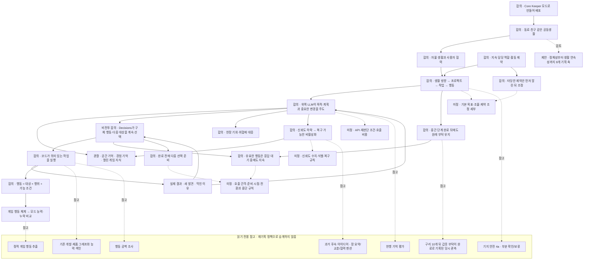

# 코어키퍼 재기획 관계 지도

최종 목표는 AI 단톡방 멤버들이 게임 안에서 동료로 함께 플레이하는 경험을 Core Keeper 모드로 만들어 배포하는 것이다. 모드가 제공할 **동료·친구 같은 경험**을 통해 다른 기획 합의로 이어진다. [제작자의 최종 목표](../2026-11-07-모드배포-최종목표.md)

이 폴더는 처음에 독립 재기획 그래프로 구성했다. 현재는 같은 선언과 합의 원문을 [프로젝트 지식그래프](../../지식그래프/README.md)의 생성기가 함께 읽는다. 개발 작업은 프로젝트 그래프의 `node tools/product.mjs intent`에서 시작한다. 이 지도는 기획 부분만 볼 때 사용한다. 기존 기획·구현·조사는 근거와 시점이 표시된 참고 항목이다.

## 전체 관계

실선은 재기획 안의 방향·의존 관계이고, 점선은 검토 항목 또는 외부 참고다. ‘합의’는 구현 완료가 아니라 방향 합의다. 연결을 읽기 쉽게 묶은 해석은 [관계 목록](관계목록.md)에 별도로 표시했다.



## 큰 그림에서 다음 기획으로

| 질문 | 연결해서 볼 곳 | 아직 정하지 않은 것 |
|---|---|---|
| 어떤 동료인가? | P.experience → P.life → P.hierarchy | 정체성·성격·관계 규칙, 기본 생활 목표 문구 |
| 재료 수량을 채우면 갑옷 부탁은 어떻게 되는가? | P.hierarchy → P.original-request → P.valid-action / R.copper | 개선판에서 갑옷 제작까지 이어지는지는 후속 실게임에서 확인한다. |
| 부탁을 어떻게 해내는가? | P.hierarchy → P.cycle → P.agency → P.execution → P.result | 도구 API, 재판단 조건·빈도, 프로젝트 선택·조율·완료 규칙 |
| 비전투 반복 작업은 어떻게 매끄럽게 이어지는가? | P.agency → P.noncombat-choice → P.noncombat-continuity / P.noncombat-next | Decisions의 호출 간격·준비 시점·전환 규칙. 유효한 행동은 응답 대기마다 멈추지 않고, 다음 대상도 Decisions가 선택한다. |
| 기억은 왜 필요한가? | P.agency → P.spatial / P.events → 원문 | 목적지·준비·대안을 판단하는 입력이다. 저장·검색이 있다고 기억을 활용하는 플레이가 완성된 것은 아니다. |
| 틀린 기억은 어떻게 다루는가? | P.agency → P.confidence → P.inactive | 신뢰도 수치·대상 식별·복구 규칙. 확인 실패와 틀림, 현재 상태와 과거 사건을 구분한다. |
| 행동 범위를 무엇으로 정하는가? | P.execution → P.action-unit → P.game-first | 게임 행동 체계와 모드의 실제 제공 능력 비교는 후속 과제다. 정적 추출 결과가 게임 행동 전수 또는 실게임 성공을 뜻하지 않는다. |
| 기존 것에서 무엇을 가져오는가? | 각 노드의 ‘참고’ 관계 → R.* | 아직 가져오기로 결정한 것이 아니다. 이전 기획과 구현을 비교할 근거로만 둔다. |

각 ID의 내용·상태·출처·연결은 [전체 노드와 관계](관계목록.md)에서 볼 수 있다. 자료를 기계로 이어 쓰려면 [graph.json](graph.json)을 읽는다.

## 대표 흐름: 철검을 만들어 달라는 부탁

**원문의 설명용 사례이며 현행 기능의 성공 사례가 아니다.**

동료가 부탁을 이해한다 → 제작 조건·현재 자원을 확인한다 → 공간·경험 기억에서 조달 위치와 과거 막힘을 찾는다 → LLM이 대상·수량·준비·순서를 정한다 → 코드가 이동·채집·제작 작업을 수행한다 → 실제 결과와 현장 기회를 보고 LLM이 순서를 고치거나 계속한다 → 부탁의 완료로 이어 간다.

수량 충족은 실행 결과의 사실이고, 추가 채집이나 귀환은 LLM의 결정이다. 이 흐름을 실제로 제공할 API와 재판단 조건은 미정이다. 현재 철광석 채집 목표 등 실행 연결 공백은 [별도 조사](../2026-11-06-행동누락조사/03-findings.md)로 확인해야 한다.

비전투의 구체 행동은 [연속 판단 합의](../2026-11-07-비전투-연속판단.md)로 보완했다. 위쪽 LLM은 목적·계획을 유지하고, Decisions는 갱신된 상황에서 계속하기·대상 변경·이동·중단 및 다음 대상을 선택한다. 유효한 행동은 응답을 기다리는 동안 계속하며 완료 전에 다음 선택을 준비한다. 넓은 구역을 코드가 자율 처리하는 방식으로 판단을 줄이는 것이 우선 방향은 아니다. 구체 호출 간격·비용·준비 시점·전환 조건은 미정이며, 전투 방향은 이 합의에 포함하지 않는다.

## 출처와 경계

- 재기획 근거 11문서는 11월 6~7일의 합의를 담는다. [모드 배포 최종 목표](../2026-11-07-모드배포-최종목표.md), [플레이 경험](../2026-11-07-플레이경험과-기획큰그림.md), [목표 계층](../2026-11-07-목표계층과-제약자율조정.md), [계획 주도권·기억](../2026-11-07-동료형AI-계획주도권.md), [모드 관점](../2026-11-06-모드그래프-사용자관점.md), [대상과 행위](../2026-11-06-게임그래프-대상과행위.md), [수행 순환](../2026-11-06-행동중심모드-수행흐름.md), [비전투 연속 판단](../2026-11-07-비전투-연속판단.md), [현장 발견](../2026-11-07-현장발견과선택지.md), [행동 취소의 판단 주체](../2026-11-07-행동취소-판단주체.md), [공통 실행 합의](../2026-11-07-공통실행-합의.md).
- 11월 6일 수행 순환에서 미정이던 LLM/코드 역할은 11월 7일 합의가 구체화했다. 구체 API·판단 주기까지 확정한 것은 아니다.
- ‘8개 기획 축’, ‘코어를 예쁘게 가꾸기’, 진행 유지·재개·휴식의 상세 구조는 제안/논의로 구분했다. 철검·농사 담당 같은 사례가 실제 목표·역할 배정을 뜻하지 않는다.
- 과거 장 요약·교훈 메모·AI 간 멘션은 후속 아이디어로 참고 연결했다. 현재 기억 편집 범위가 신뢰도 하락이라고 해서 과거 할 일을 취소한 것으로 해석하지 않았다.
- 기존 자료는 기록 당시 기준판의 평가·정적 조사·구현 색인이다. 최신 전체 코드 감사를 하지 않았으며 4a는 보류 상태다. 게임 실행·외부 LLM 호출을 재개하지 않았다.
- 참고 근거는 9문서다. 그중 [구리 갑옷 사례](../2026-11-07-동료행동-현재부족분.md)는 11eb461 코드와 보존 로그를 비교한 조사다. 새 기획으로 채택한 내용은 합의 원문에서 확인한다.
- 위쪽 LLM의 약 2분 주기는 현행 구조 설명으로 남긴다. 새 재기획의 고정 호출 주기로 승계하지 않았다.

## 조회와 갱신

이 폴더에서 실행한다. 외부 패키지·서버 없이 Node.js로 로컬 문서만 읽는다.

```powershell
node graph.mjs overview
node graph.mjs show P.agency
node graph.mjs path P.release-goal P.experience
node graph.mjs path P.release-goal P.execution
node graph.mjs path P.experience Q.memory-rules
node graph.mjs path P.experience R.missing
node graph.mjs path P.agency P.noncombat-next
node graph.mjs source P.noncombat-choice
node graph.mjs source P.agency
node graph.mjs find 미정
node graph.mjs check
```

원문 합의가 바뀌면 [source.mjs](source.mjs)의 해당 노드·관계·근거를 갱신한다. 이 폴더의 보조 색인은 `node graph.mjs build`와 `node graph.mjs check`로 갱신한다. 이어서 [프로젝트 그래프 폴더](../../지식그래프/README.md)에서 `node tools/product-build.mjs`와 `node tools/product.mjs check`를 실행해 통합된 조회 결과를 갱신한다.
